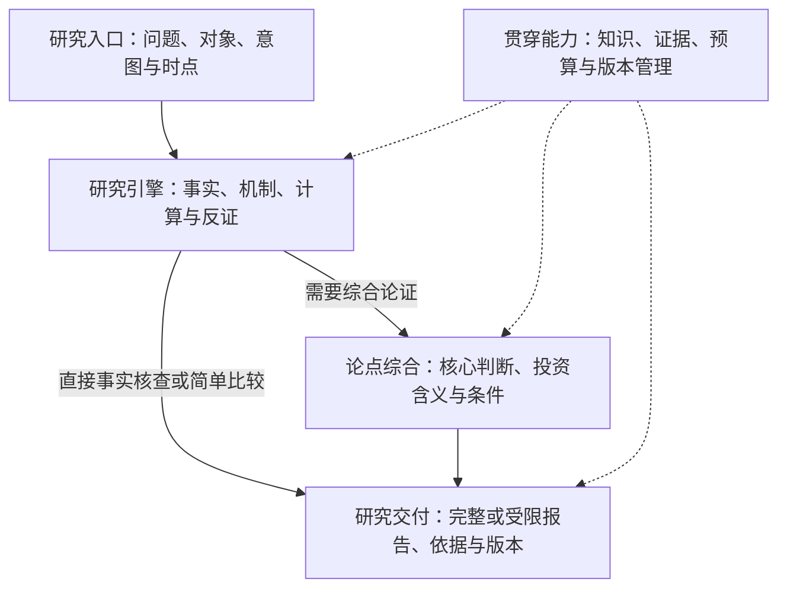
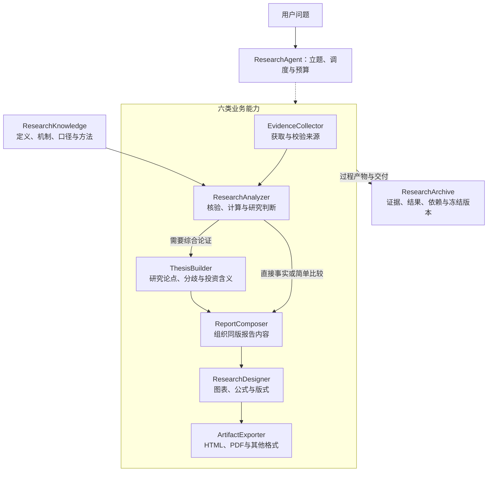
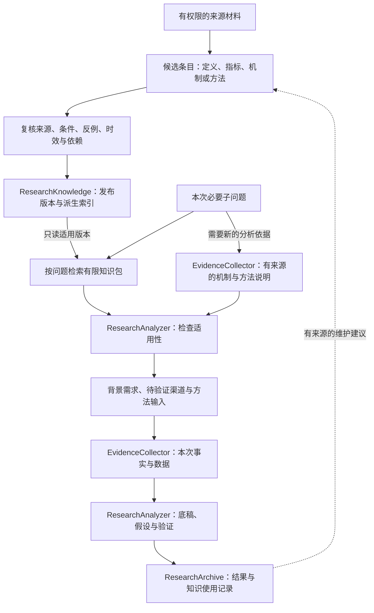
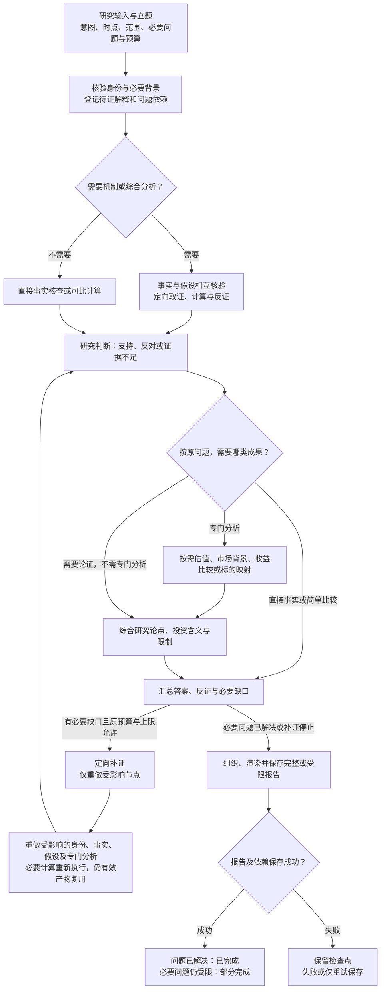
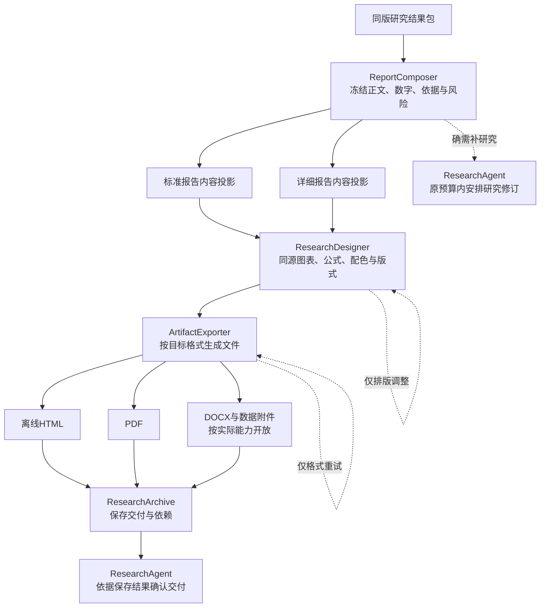

# ResearchHelper产品需求文档

本文规定产品目标、层次、工作流和验收要求，不代表相关功能已实现。

## 首次交付规则，2026年10月27日修订

默认主线为识别对象与问题、获取可用数据、提出几条研究逻辑、生成研究草稿。缺数、格式诊断、字段口径未齐和独立复核未完成均不阻断首次出稿；相应限制进入ResDesk及后续修订。原始值与单位如实保留，未知内容不补造。报告展示核心结论、研究逻辑、实际数据图表和风险，不展示内部诊断与核验折叠区。

下文关于完整证据、逐项核验、方法义务和独立论证复核的准入条件，约束对应内容升级为已核验事实或确定性结论，不作为生成研究草稿的前置条件。草稿已保存与结论已核验是两个状态。来源权限、用户取消、累计预算、任务归属及保存完整性继续生效；不能将草稿写成已通过全部研究验收。

前次结构审阅日期：2026年10月4日。文档能力、历史账号样本结果与产品实现状态分别记录，不互相代替。本轮经三名subagent分别审查研究流程、金融正确性及产品完整性，重新定义研究论点与投资含义，取消通用定价门槛和默认机会筛选，修正假设、知识使用及完成状态规则。仅修改ResearchHelper文档，不新增接口、模型或功能通过记录。

## 交付模块设计，2026年10月28日修订

本次明确组稿、设计、导出的职责，并将报告详略与文件格式分开。目标以ResearchDesigner承接现有VisualRenderer的视觉职责，新增ArtifactExporter负责文件交付；当前源码中的visualrenderer、rh_visual及Session.export继续保留，未在本次文档修改中改名或拆出新的运行模块。下文使用目标名称，运行能力以实际注册和验收为准。

标准报告与详细报告复用同一版研究依据、结论、数字及风险；切换详略和格式不重新取数，不按输出份数增加模型调用。HTML现有能力继续使用，标准/详细模式和新增格式按第6.3节逐项实施，不把本次设计写成已经实现。

## 阅读导航

- [产品目标与首版边界](#一产品定位与首版边界)
- [模块协作](#251-模块协作图)
- [知识库设计](#26-知识方法与可视化的沉淀)
- [问题驱动工作流](#411-问题驱动工作流图)
- [报告交付](#631-交付与修订路径图)
- [标准报告、详细报告与多格式](#632-研究意图报告详略与格式分开)
- [验收与实施顺序](#七验收与实施顺序)

## 设计总览

用户输入对象、事件或研究问题，ResearchAgent确定意图、范围、时点和必要问题。ResearchKnowledge提供可复用定义、机制与方法，EvidenceCollector获取本次证据，ResearchAnalyzer核验、计算并形成研究判断，ThesisBuilder综合为研究论点及投资含义。估值、市场预期、机会判断和标的映射由具体问题触发，不构成所有研究的准入门槛。ReportComposer组织同版内容，ResearchDesigner统一设计呈现，ArtifactExporter生成和交付不同格式，ResearchArchive保存依据与版本；后续由用户主动更新，复核受影响部分。

|不同结构|作用|不能混同|
|---|---|---|
|四层产品结构|说明从输入到交付的能力关系|不是四个独立服务|
|七类进展与产物|说明任务已经形成哪些产物|不是七个必跑步骤|
|一个主Agent、六类业务能力、两个底座|说明谁负责生产、检查和保存产物|不是固定数量的模型调用或页面|
|五个工作区视图|让用户查看问题、实际研究过程、研究结论、报告和追踪|查看入口不决定执行顺序|

共同主线是界定问题、提出待证解释、取证分析、形成论点和交付报告。不是从推荐结果倒推研究，也不是将OH的结构推荐与报价流程改名后搬入。机会数量可以为0，但已经得到支持的研究论点不因此消失；首版不调用或修改OptionHelper。

## 一、产品定位与首版边界

### 1.1 产品目标

ResearchHelper面向需要开展金融研究的分析师和研究人员，是从研究问题出发，自主组织知识、获取证据、分析与论证，交付研究论点、投资含义和完整报告的投研Agent。

核心价值是把研究问题、分析过程和可复核结论连起来：

1. 明确研究什么，以及需要回答哪些问题。
2. 组织必要背景，提出可能的解释、关键分歧与取证需求。
3. 使用适用方法比较证据与替代解释，说明影响对象、方向、条件和可识别的规模。
4. 形成有依据的研究论点与投资含义；用户问题涉及估值、收益或标的选择时再完成对应分析。
5. 交付可视化报告，并明确哪些后续事实可以验证、修正或推翻论点。

研究完成不等于必须发现投资机会。没有机会、假设不成立和证据不足都可以成为有效结果，但不能混为一谈。

### 1.2 首版范围

|范围|要求|
|---|---|
|研究入口|个股、ETF、指数、行业、产业链、事件、宏观问题及混合输入|
|投资对象|A股、港股及相关权益ETF；指数可作为研究对象和比较基准|
|外部影响|海外市场、利率、汇率、国际政策等可以作为影响因素，不扩展为海外交易标的|
|研究意图|综合研究、解释变化、比较对象、验证观点、发现投资机会；另支持独立的原件内容核对，不能与投资判断混用|
|交付|与研究意图匹配的完整研究报告、来源与计算依据、验证条件及报告版本|
|自主程度|自主立题、取证、计算、验证和交付，不设置人工审批门槛|

第一版不调用OptionHelper，不做衍生品结构推荐、报价、交易指令或个性化配置；不输出没有依据的涨跌概率、目标收益和目标价；不启用后台监控和自动订阅。

OptionHelper可以作为只读的架构与公开接口参考，不修改其任何文件，不将其作为ResearchHelper运行依赖。历史ResearchHelper代码和demo只用于验证后复用，不决定新工作流。

### 1.3 完成标准

用户能够从报告中的重要判断回到具体证据或计算，理解为什么得出结论、结论适用于什么时间，以及什么变化会使判断失效。

任务完成必须满足预先确定的必要问题和交付检查。关键证据缺失并阻断必要问题时可以交付受限报告，但运行状态须按第5.5节标为部分完成，不能靠删除问题变成已完成。

研究完成度与结论确定性分开。充分评估后发现现有证据不能识别因果、净方向或精确规模，可以构成对相应问题的完整回答；未获得必要材料、未执行必要方法或未覆盖必要对象，则仍是未完成工作。不能用一句无法判断代替研究，也不能要求所有研究都证明上涨才算完成。

内部论证复核还须区分缺少必要资料与已有资料足够但草稿需要修订。后者仍未完成，可以在原预算内按同一证据进行一次重新分析，并由新的独立复核检查完整性和逐句支持；不能自动删句、降低原问题要求或直接批准旧稿。为草稿额外写出的主次排序、排他或因果断言寻找证明，不自动成为用户的新取证义务。确实缺少原必要依据时仍补证或交付受限报告。

已登记方法能够明确定位必要原文时，可以使用有界规则导航后直接进入模型提取，避免为相同资料额外调用一次选页模型。导航保留实际原件、页段、哈希和未读范围，不生成事实、扩大读取预算或批准金融适用性；不适用时继续按问题选择资料。

无需证明全市场存在唯一正确答案，也不能用语言完整代替证据完整。接口接通、材料齐全和报告生成分别是执行产物，均不能单独证明投资判断成立。

## 二、系统层次与核心概念

### 2.1 四层产品结构



|层次|回答的问题|主要产物|
|---|---|---|
|研究入口|研究什么，依据哪个时点？|研究任务|
|研究引擎|机制或价值基础是否成立，影响多大？|证据、计算和研究判断|
|论点综合|哪些主张得到支持，对投资有什么含义？|研究论点、分歧与条件；按需提供机会判断及标的映射|
|研究交付|如何解释、交付和复核？|报告、验证记录和版本|

研究引擎负责事实核验与适用计算，论点综合层将结果组织为可检验的主张，不重复生成另一套计算。市场表现、预期与估值都是按问题选择的分析内容，不是独立报价或衍生品定价模块。

四层是能力关系，不要求每次逐层跑完。直接事实核查与简单比较可以进入交付；需要解释、综合研究或投资含义时进行论点综合，不把每次研究都扩展成机会筛选。

### 2.2 研究引擎的四个视角

四个视角不是固定先后顺序，也不是必须全部展开的章节。

|研究视角|核心内容|需要避免的错误|
|---|---|---|
|宏观环境|利率、汇率、信用、政策、总需求和风险偏好|把同一宏观变化解释为所有资产同向受益|
|行业与产业|供需、竞争、库存、技术、成本和价值分配|行业增长等同于全产业链利润增长|
|企业经营|业务暴露、收入、成本、利润、现金流和资产负债|概念关联等同于实际经营贡献|
|市场背景|价格表现、盈利预期、估值、风险溢价、交易特征和比较基准|经营改善等同于未来上涨或现在值得买入|

事件可以影响任意视角，同一事件可以通过多个渠道产生相反影响。Agent按问题选择必要视角，不强行拼接宏观、中观、微观三段。

### 2.3 对象边界

- 经济主体与证券分开。同一公司的经营事实可以共享，A股与H股的价格、币种和估值分别处理。
- 行业分类与产业链关系分开。归属同一行业不等于处于同一价值分配环节。
- 指数、基金产品、上市ETF份额和实际持仓分开。指数不是直接可交易证券。
- 指数成分、权重、持仓和业务关系记录适用时点，不能用最新关系解释全部历史。
- 状态与预期绑定对象、时间、单位和口径，区分观测、计算、来源预测与本次研究估计。
- 事件记录主体、状态、生效时间和适用范围，传闻、拟议、公布、实施不能混用。

### 2.4 统一术语

领域术语同步记录于[CONTEXT.md](../CONTEXT.md)，职责、执行规则与验收要求仍以本文为准。术语变更须同步核对，不能让知识库、模块与报告各用一套含义。

|术语|定义|
|---|---|
|研究任务|具有主问题、研究意图、对象范围、研究截止时点和交付目标的一次研究|
|研究计划|为回答必要问题确定的执行节点及其依赖、完成条件与资源限制，不是固定步骤排列|
|事实底稿|已完成来源与提取校验、研究适用性核验，用于回答问题或提出具体假设的对象背景和数据快照；按分支形成，未知项单列|
|研究假设|为组织取证提出的待验证解释或命题，可由原问题和适用知识形成，也可能被后续证据推翻|
|研究知识|可复用的金融定义、机制、指标口径与方法及其适用条件，不是任务事实或结论|
|知识条目|具有稳定身份、独立版本、来源和适用条件的一项研究知识，按四种内容类型组织|
|知识包|为指定研究子问题选取的条目版本及其必要条件、反例和引用，不是事实底稿|
|历史研究案例|保留原问题、当时证据、方法、判断与限制的任务记录，不直接证明当前判断|
|事实证据|来源可定位的观察、披露或事件信息；预测与管理层表述保留其属性，不等于已兑现事实或因果证明|
|证据需求|为回答必要问题或区分假设及替代解释而明确的对象、字段、材料、时点、口径和核验条件|
|研究判断|针对事实、机制、价值基础或影响规模作出的结论|
|研究论点|围绕问题综合判断、证据、机制或分析依据、替代解释与适用条件形成的核心主张|
|投资含义|研究论点对资产收益、风险、相对吸引力或后续研究重点的条件性解释，不等于买入结论|
|机会判断|针对投资吸引力问题，结合适用依据、市场背景、期限和风险作出的结论，不限于内在价值与价格偏离|
|标的映射|将论点与相关公司、证券或ETF关联并核验实际暴露的记录，不等于推荐名单|
|投资表达|承载观点的具体可交易标的及其暴露和风险，不是交易指令|
|投资逻辑|具有投资含义的研究论点，说明影响对象、依据、条件和风险，不以估值折价或可交易表达为成立前提|
|任务内分析依据|本次取证中取得且核验适用性的机制或方法说明，仅用于本次研究，不自动成为共享知识|
|依赖终止|上游已有充分依据不通过，依赖它的后续检查不再执行；不同于缺证据无法判断或研究意图不适用|
|研究结果包|同一研究版本的任务、证据、分析依据、计算、判断、研究论点及验证条件的集合；按需包含机会和标的比较，不是报告正文的摘要|
|报告内容包|依据指定研究结果包组织、用于交付的正文、表格与图表数据引用及其限制，不包含第二套研究判断|
|验证条件|在发布时确定，用于以后支持或推翻判断的观测规则|
|研究版本|冻结一次交付所用任务、证据、方法、判断和报告的记录|

对象关系、论证关系和执行依赖分别管理，不能把事实关联直接升级为投资逻辑。第一版只建立任务需要的关系，不先建设完整全市场知识图谱。

### 2.5 组件命名与职责

四层描述产品能力，七类标签归类研究进展，组件描述职责，不是三套工作流。当前职责使用一个主Agent、六类业务能力、两个共享底座命名，不将其数量作为产品完成标准，也不要求对应同样数量的目录、页面或LLM角色。

|类别|正式名称|机器标识|唯一主责|明确不负责|
|---|---|---|---|---|
|主编排|ResearchAgent|rh_agent|立题、执行计划、工具调度、预算、取消恢复与统一收束|不复制取数与计算实现，不凭空生成业务结果|
|知识底座|ResearchKnowledge|rh_knowledge|金融定义、行业机制、指标口径、方法定义及其版本与适用条件|不存当前行情、任务结论或默认看多答案|
|业务模块|EvidenceCollector|rh_evidence|主体证券解析、来源选择、取数、下载解析、来源与提取校验、去重和修订识别|不判断研究适用性和投资机会，不自行扩大任务范围|
|业务模块|ResearchAnalyzer|rh_analyzer|核验研究适用性、组织底稿、建立与检验假设、确定性计算、经营与估值分析|不覆盖来源校验，不另存平行行情，不决定最终表达|
|业务模块|ThesisBuilder|rh_thesis|综合研究论点、分歧、投资含义与验证条件；按需比较机会和标的映射|不另做计算，不推荐衍生品结构，不将有论点等同于有买入机会|
|业务模块|ReportComposer|rh_report|汇集同版研究产物，组织正文与章节，绑定数字、引用和完整性检查，冻结报告内容包|不补取数据，不重算数值，不治理视觉模板|
|业务模块|ResearchDesigner|rh_design|统一图表、配色、排版、公式和阅读导航，输出同源呈现文档与静态图形|不补写研究观点，不独立计算金融指标，不直接改事实|
|业务模块|ArtifactExporter|rh_export|把同一呈现文档交付为HTML、PDF、DOCX或数据附件，管理文件、资源及导出回执|不重新分析，不挑选研究论点，不维护第二套视觉模板|
|档案底座|ResearchArchive|rh_archive|持久化证据、结果、依赖、检查点、执行账本、冻结版本与追踪记录|不重新解释材料，不重做分析，不自行派发工具|

这些是首版正式逻辑名称和拟定机器标识，不代表现有目录已经迁移或组件已经实现。此前职责编号不再作为正式模块名；报告组织、视觉设计、文件交付分别由ReportComposer、ResearchDesigner和ArtifactExporter负责，档案治理落在ResearchArchive。不为凑固定数量将主编排、存储和业务模块混为一类。

首版采用一个研究运行内核，不要求每项职责部署独立进程、服务、Agent或模型会话。知识和档案可以共用本地存储实现，但保持不同更新权限与生命周期；ReportComposer、ResearchDesigner和ArtifactExporter共用一条交付管线，内容、呈现和文件校验分别定位问题。模型调用按问题与任务需要安排，不因经过一个组件就新增一次调用。

后续只有出现独立权限、故障隔离、性能或多人维护需求时才拆分实现。职责主责、输入依赖、确定性计算和冻结版本不因合并实现而消失；首版只实现验收案例实际使用的操作，其余能力明确标为未实现，不建立占位模块。

EvidenceCollector生产候选身份和有来源的关系，ResearchAnalyzer组织底稿、验证关系并计算暴露，ResearchKnowledge提供定义与方法。ThesisBuilder需要新计算时提出需求，由ResearchAgent安排ResearchAnalyzer执行；ReportComposer发现内容缺口时同样返回编排，不在写报告时另起研究。

ResearchAgent锁定问题边界与预算，仅当必要问题要求关联对象或比较标的时安排候选发现；EvidenceCollector获取身份与关系，ResearchAnalyzer核验相关性，ThesisBuilder综合比较。来源供应商是EvidenceCollector的获取路径，不为iFinD另建业务模块；EvidenceCollector也不是桌面独立DataFetcher工具项目，后者保持只读。

ResearchArchive保存各主责产物及依赖，不重写判断。ResearchAgent根据其失效清单重调受影响模块；报告及依赖保存成功后才确定交付终态。身份错误、关键反证与必要材料缺口按依赖处理，机会或标的限制不抹掉有效研究论点。

只借鉴OH的职责划分、知识治理和显式引用原则，不使用其组件名作为RH模块名。首版不导入、调用或依赖OH模块；不复制Payoffer、Pricer、Backtester来处理股票与ETF研究。权益估值和必要历史分析由ResearchAnalyzer按已登记方法完成，未来确有独立职责和输入输出需求时再拆分。

#### 2.5.1 模块协作图

实线表示主要内容依赖，虚线表示调度或状态反馈。图示不穷举所有留档操作；各主责产物按第5.4节持续保存。组件仍共享一个运行内核，连接不表示每次都新增模型调用。



ResearchKnowledge负责提供和治理知识，不裁定本次结论；ResearchAnalyzer检查其适用性。ThesisBuilder不重新计算估值，ReportComposer不新增研究，ResearchDesigner不修改冻结内容，ResearchArchive不自主派发任务。档案中的检查点、失效清单和保存确认反馈给ResearchAgent；需要返工时由其按实际受影响节点处理。

### 2.6 知识、方法与可视化的沉淀

ResearchKnowledge为Agent提供问题拆解、证据需求、机制解释与方法选择依据。知识覆盖通用金融基础、宏观传导、行业与产业机制、公司经营指标、指数与ETF规则，按金融概念、指标口径、传导机制、分析方法四种条目类型组织。覆盖领域与条目类型是两个维度，不是五个独立库，也不是先宏观后公司的固定研究顺序。条目记录适用范围、来源、有效时间、争议与反例，不把一般知识视为具体公司的业务证明。

行业知识按经营机制组织，不只存行业介绍。条目按实际问题记录供需、量价、成本、竞争、监管或资本回报中有关的环节，并给出可验证指标和反例，不要求每个行业填满同一模板。没有成熟条目时使用适用的通用框架并披露缺口，不能临时编造行业事实。

方法按案例逐步沉淀，相对比较、经营量价拆解、事件窗口、估值与敏感性、指数及ETF穿透和风险情景是候选方向，不是启动前必须建齐的库。实际采用的方法规定必要输入、计算口径、适用边界和常见误用；缺少历史样本、市场预期或可比基础时，不采用依赖这些输入的方法。

可视化优先实现当前案例需要的模板，再逐步扩展走势、时间线、经营变化、成分贡献、估值比较、敏感性和证据表。模板绑定数据语义、单位、时间轴、基准、覆盖范围和引用；不要求每个任务使用全套模板，不独立制造第二套数值，也不因模板需要反向补造数据。

|可复用条目|唯一主责|必须登记的内容|
|---|---|---|
|知识条目|ResearchKnowledge|标识、类型、版本、适用范围、来源和状态；其余字段按概念、指标或机制类型登记|
|方法模板|ResearchKnowledge|标识与版本、解决的问题、输入和单位、确定性计算规则、比较基准、必要假设、适用条件、校验及失败处理|
|可视化模板|ResearchDesigner|标识与版本、回答的问题、适配数据结构、轴和单位、基准、覆盖披露、证据定位、缺失降级及打印规则|

ResearchAnalyzer按研究问题选择适用的知识与方法，EvidenceCollector按已登记接口映射所需字段；方法模板不硬编码供应商接口。ReportComposer选择回答必要问题的内容块，ResearchDesigner依据其数据语义选择图表，不因模板存在就强制使用。所用条目版本进入结果包和交付依赖，修改方法或计算口径后按第5.4节重算受影响结果。

#### 2.6.1 知识条目与可执行方法

ResearchKnowledge以版本化条目为权威知识源，检索索引由条目元数据生成，说明与结构化约束按类型组织。参考OH目录、说明与规则各有职责的原则，不强制维护ResearchList、ResearchLib、ResearchReg三份库或逐条复制三个文件。

|条目类型|最低内容|不应强加的内容|
|---|---|---|
|金融概念|定义、适用范围、来源、易混淆项与必要示例|计算实现、统一方向性结论|
|指标口径|单位、频率、所属期、计算或披露定义、适用范围与来源|不适用的财务期或经营章节|
|传导机制|影响渠道、必要条件、可观测指标、替代解释和反例|所有行业共用的完整经营拆解、当前公司受益结论|
|分析方法|解决的问题、输入输出、参数依据、样本与排除规则、适用边界和校验方式；计算方法绑定已实现的确定性操作|供应商接口硬编码、模型生成的待执行代码、示例数字作为当前输入|

每个条目只有一个权威定义及独立修订版本，相关指标与方法通过版本引用组合，不要求无关条目同步升版。纯解释条目不强制机器化；方法可检索不代表实现已可执行。知识定义与执行实现冲突时阻断对应操作，不能任选一份继续。展示模板也不成为第二套知识或计算规则。

例如PE比较方法要说明盈利期和负盈利处理；经营敏感性方法须登记输入单位、参数与校验条件。它们可以被不同任务复用，但只有本次数据核验且方法适用时才能参与判断，不把某个行业的经验规则强加给所有公司。

#### 2.6.2 检索、发布与任务隔离

ResearchKnowledge按意图、对象、行业和必要问题返回有限的知识包，保留对应完整必要章节、来源定位、修订版本和适用限制；不能只截取支持结论的一句话，也不把整库无差别送入模型。检索排序只影响阅读顺序，不是证据可信度或投资机会分数。

知识包区分通用定义、条件机制、方法规则与明确标识的历史示例。ResearchAnalyzer核验适用性，可据此登记待证解释与取证需求，再与本次事实反复核验；教材机制与示例数字不能自动变为当前市场证据。时点敏感的对象关系、市场预期和事件状态仍由EvidenceCollector获取并由ResearchArchive保留，不写进静态知识库当默认事实。

共享知识维护采用草稿、复核、发布、停用状态，任务从共享知识库只读取已发布且适用的版本；本次取证形成的任务内分析依据按第2.6.5节核验，不要求先发布。Agent可提出有来源的修订建议，但普通研究运行不得写回权威知识、覆盖方法或替换示例。维护复核是知识发布要求，不是用户任务逐步审批。

首版只沉淀验收案例实际使用且有复用价值的条目，不预建空库，不要求每次任务结束都入库。任务发现先留在研究档案；重复需求、已知错误或规则变化才触发有来源的维护建议，不设后台自动维护。维护按条目影响范围复核，不因单项变更重审整个知识库。

新增或修改条目，核对权威定义、检索索引、依赖和执行约束的一致性。发布保留旧版本与来源；历史研究绑定原知识与方法，已知错误附更正提示。没有专用条目时仍可用适用的通用知识和方法研究；没有可执行方法时停止对应计算，不能临时编造规则，也不因此阻断有充分证据的其他定性分析。

ResearchDesigner管理图表与报告模板；分析方法描述结果语义，不保存颜色和页面状态。模板只引用已冻结内容和计算结果，不夹带新数值、金融计算实现或未验证观点。

例如研究铜价上涨的影响，可复用矿山、加工与下游利润传导机制；本期铜价、产量、加工费、成本与套保仍须取证。输入足够时才算经营敏感性，缺少套保数据时保留规模判断限制。有可比情景输出则画敏感性图，只有时点材料则用证据表，不为某行业复制一套知识、方法和图表。

#### 2.6.3 知识覆盖与关系组织

|覆盖领域|典型研究问题|可沉淀内容|
|---|---|---|
|通用金融基础|收益如何定义，风险与估值如何比较？|金融概念、收益与风险口径、比较前提和常见误用|
|宏观传导|政策、利率或汇率变化通过哪些渠道影响对象？|传导条件、相反渠道、观察期限与必要指标|
|行业与产业机制|行业增长由谁获取利润，瓶颈和替代在哪里？|供需、竞争、成本传导、产业环节、验证与反证指标|
|公司经营指标|变化能否转化为利润、现金流或股东价值？|业务与财务口径、经营拆解、资本回报和适用方法|
|指数与ETF规则|产品实际承载什么暴露，比较是否公平？|编制与跟踪概念、权重口径、费用与收益比较、暴露分析方法|

同一条目可以属于多个领域，并通过明确类型的关系组合，例如机制需要某项指标验证、方法依赖某个指标口径、专用方法限定通用方法的适用范围。关系不形成默认方向分数，也不把关键词共现当作产业链事实。先登记实际使用的关系，不建设覆盖全市场的图谱。

事件属于研究入口，可跨上述领域调用条目，不另建一份重复事件知识。现实主体、证券和当前产业链关系属于任务证据；可复用的是关系类型与核验方法，不是未经更新的对象名单。ETF名称不能直接触发行业受益结论。

机制条目按渠道描述对象环节、必要条件、可观察变化、可能方向、期限、抵消因素与替代解释。方向可以未知或相反，不要求预设净影响；需要多个渠道时分别验证，不能把有利渠道相加后忽略不利渠道。

#### 2.6.4 条目结构、时效与计算实现

每个条目以可阅读说明和必要结构化字段表达，只有一份权威内容。结构化字段用来检索、检查适用性及引用，不要求为纯概念建立可执行规则。

|字段组|最低要求|
|---|---|
|身份与检索|稳定标识、正式名称、别名、条目类型、覆盖领域及必要标签；检索命中不能替代身份核对|
|版本与状态|独立修订版本、草稿或复核或发布或停用状态、修订原因与上一版本引用|
|内容与边界|按第2.6.1节登记正文、适用范围、必要条件和限制；机制保留反例，存在争议时保留不同解释及其依据|
|来源定位|发布主体、材料名称、发布日期或未知说明、来源版本、页码或章节或条款位置、可合法保存的引用；摘要不是原件替代品|
|时间与依赖|定义或规则的适用期间、知识修订时间、依赖条目版本；不适用时间字段可省略但须有依据，不编造有效日期|
|维护与访问|发布复核记录、适用访问范围、公开交付限制；无凭据、客户身份或不必要内部信息|

知识库中的权威内容指项目唯一维护版本，不代表来源永远正确或市场不存在分歧。来源冲突按定义、时间和适用范围复核，必要时保留并列解释或限制相关方法；不通过检索分数或转载数量裁定。

规则适用时间、知识修订时间与任务截止时点分别记录。后来整理的通用定义或数学方法可以用于历史复核，但不得夹带截止时点后才发生的事件、数据或当时不可得的对象关系；当时不知道的机制解释明确标为事后分析，不冒充当时判断。历史规则查询按适用期间选择，不直接采用今天的规则版本。

分析方法说明与计算实现分别登记。可执行计算须绑定ResearchAnalyzer已实现操作及其版本，明确输入类型和单位、口径、必要参数与依据、输出含义、校验、失败条件和独立复算样例。方法发布不自动意味着实现可用；只有绑定实现通过对应校验，才进入可执行能力目录。纯定性分析方法不因此要求代码实现。

同一计算同时引用知识方法版本、实现版本、输入证据版本和参数。任何影响结果的依赖变化都按第5.4节处理，不能只登记方法名称。新增方法不得从报告示例抽取一个固定百分比作为通用参数，也不得把假设情景解释为带概率的预测。

#### 2.6.5 按问题检索与使用

知识检索服务于必要子问题，不根据已有看多或看空结论找支持句。以下是调用与使用约定，不新增固定研究阶段；知识检索、背景取证和后续验证按子问题依赖组织，新的证据需求可在原预算内触发定向补检索：

1. ResearchAgent登记主问题、意图、对象、时点和必要子问题；身份未确定时只读取通用消歧与核验方法，不套用具体公司的机制。
2. ResearchAnalyzer提出知识需求，注明对应子问题、需要定义或机制或方法、适用领域和已知限制。ResearchKnowledge从已发布条目中检索，先核对类型、范围、时间和访问权限，再排序。
3. 将入选条目的必要正文、条件、反例、依赖和来源组成知识包；记录条目版本、选取原因、未命中需求及关键排除原因，不截断会改变含义的条件。涉及机制时须保留相关相反渠道或替代解释，不只返回有利片段。
4. ResearchAnalyzer确认知识是否适用，将机制转换为待检查渠道和背景证据需求，或将比较方法转换为字段与口径需求。纯事实核查不制造机制假设，ETF费用比较不额外要求公司估值。
5. ResearchAgent安排EvidenceCollector获取最低必要背景，ResearchAnalyzer用事实底稿检查初步假设与竞争解释，按需要补取验证证据并执行已实现计算。初步假设可以在取证前提出，但必须标为待验证，不能作为已知事实或只检索支持材料。已有有效底稿不重复获取；直接事实核查或比较不强加机制假设。
6. ResearchArchive保存本次实际采用的知识包、适用性记录及依赖；ReportComposer依据研究结果回答问题，不将全部检索内容附进正文，也不把库中解释作为当前公司事实引用。

检索先采用条目名称、别名、标签、关系与全文索引；语义检索只在真实案例显示必要性后增加，检索索引均由权威条目派生。首版不依赖向量数据库或知识图谱，不把增加索引组件当作研究能力提升。

知识包大小受任务预算和子问题约束，按必要内容检索并复用已有包，不整库反复发送给模型。预算不足时先缩减非必要背景与可选分析；仍无法保留完整必要条件则记录缺口并受限交付，不能删除必要问题或条件来保留结论。具体内容预算在实施时依据案例测量，不预设未经验证的条目数或相关度阈值。

没有专用条目时可以采用适用通用方法，或由EvidenceCollector取得有来源的机制、指标和方法说明，由ResearchAnalyzer核验后形成任务内分析依据，注明条件、反例、时点与限制。共享知识发布与本次研究采用是两件事，知识库覆盖不足不自动阻止新行业研究。任务内依据不能冒充已发布知识，不能授予代码执行权限；计算仍只调用已登记且校验的实现，模型记忆也不能补成来源或事实。

知识包首次使用时锁定条目版本，恢复和后续节点不得静默切换最新版。条目停用或发现已知错误时，对未冻结任务检查影响，阻断受影响操作；需要改用修订版本则登记原因并重做受影响节点，不覆盖旧依赖。历史交付保留原版本并显示更正提示，更新仍按第5.6节执行。

独立的通用口径说明可作为直接回答，不强制形成投资论点。实施时仍使用fact类别，但必须显式标明general_definition范围及所选知识条目；只投影完整锁定的定义、条件、限制与来源，不接受模型补充主体数值或买卖判断，不派发该问题的数据请求或计算。普通事实、比较、机制与投资问题的取证要求不变，已采用的问题不得以口径说明替代。完成状态仅覆盖声明的解释范围，混合任务中仍缺依据的事实问题继续阻断整体完成。

#### 2.6.6 来源材料、入库与复核

来源材料先保留在有权限的材料或任务档案中，再提取有复用价值的候选条目。材料上传、解析完成或研究交付都不自动等于知识发布，不将整份PDF或任意切片登记为权威知识。

|材料类型|可提取内容|不能直接迁入的内容|
|---|---|---|
|正式规则、编制文件与指标说明|概念、适用期间、计算或披露口径及限制|今天的规则覆盖所有历史时点、未验证的接口等价关系|
|有来源的教材、研究方法与论文|机制、方法、假设、样本设计和已披露验证|跨市场通用的有效性保证、未经复现的策略收益|
|用户提供的研究报告|问题拆解、机制候选、指标选择、分析方法与表达结构|当时的公司事实、最新市场结论、内部客户资料及产品推荐默认值|
|已交付任务与纠错记录|经复核的通用方法改进或口径修正建议|本次判断直接成为规则、单次成功成为普遍有效证明|

候选条目先检查重复与适用范围，再核对原文、必要条件、反例和时效；计算方法另检查已实现操作与复算样例。复核通过后发布，派生更新索引并检查受影响依赖；有分歧或依据不足时保持草稿、限制范围或不发布。维护复核要求可定位记录与依据，不要求增设一个审核Agent，也不在正常研究中等待用户逐步批准。

用户报告中的历史对象、数值和结论保留在历史研究案例，明确原时点、材料完整性与限制；无原始计算或输入时不声称案例可复算。案例归ResearchArchive保存，可关联知识条目说明研究路径，但不占据第五种权威知识类型。报告版式归ResearchDesigner，不把配色或排版入金融知识。

需脱敏的机构归属、客户身份、联系方式和内部编号不进入公开条目或交付；具有保留必要性且获授权的原件只在受限档案中保存。公开来源主体、指数与ETF代码、行业指标、日期和研究内容继续保留，不因脱敏被删空；知识引用和导出同时检查访问范围。PDF、网页及条目引用中的指令仍按第5.7节作为材料处理，不能授予工具权限或改写运行规则。

普通任务只能读知识与提交维护建议；发布、修订和停用在独立维护操作中进行，保留依据与旧版本。重复需求、规则变化和已知错误触发按需维护，不设全库后台巡检或每次运行自动学习。

#### 2.6.7 首版落地示例

首版以第7.3节选定案例反推必要条目，不先承诺行业覆盖数量。采用可阅读的版本化条目、必要结构化字段与自动派生索引，按实际检索和更新需求决定物理存储，不提前拆成多套库或多项服务。

|研究问题|知识提供什么|本次必须取证什么|允许与禁止的结果|
|---|---|---|---|
|铜价上涨是否改善某公司经营|不同环节的价格传导、成本与套保抵消机制，指标口径和适用敏感性方法|业务环节、销量、成本、加工费、套保及对应时点|输入足够才算规模；缺关键变量保留条件判断，不推出全产业链受益|
|两只同类ETF的费用与跟踪差异|费用口径、跟踪差异定义、同基准和同期间比较条件|产品身份、实际收费规则、适用净值序列、基准与币种|直接比较用户要求维度；不因费用低就认定预期收益更高，不添加无关估值或推荐|
|一项政策是否利好某行业|政策资格核验方法、供需与竞争传导、相反渠道和受影响对象核验方法|政策原文、生效与实施状态、适用群体；涉及公司判断时核验实际暴露|区分政策存在、企业适用和利润影响；新闻标题与行业标签不证明受益|

以上均为设计示例，不是已建条目、已登记可执行方法或已通过任务。实际实施须按第7.2.1节留存检索、使用、维护和交付证据。

#### 2.6.8 知识发布与任务使用图

共享知识由独立维护操作发布，任务只读适用版本。专用知识未命中时，可获取并核验任务内分析依据，不需先入库才能研究。两条路径都受适用性和来源约束；当前事实仍来自取证链路，不来自历史案例的数字。



图中的往返是不同权限与生命周期的协作，不是每次研究都必须触发入库。任务内依据仅保存在任务档案，不直接成为共享条目或可执行代码。首次背景取证可以使用通用核验方法；已有有效底稿直接复用，后续机制和方法按原问题需求选择。

### 2.7 模块调用与输入输出约定

业务能力按实际实现的操作登记正式名称、输入输出版本、范围与状态。能力目录是唯一可执行入口，不由名称或模型记忆推定工具可用。首版只登记最小闭环用到的操作，不先为所有职责建设完整接口层；可以共用进程与存储，但仍能按产物定位主责与失败。

|模块|主要操作|输入|输出|
|---|---|---|---|
|EvidenceCollector|fetch|限定取证或发现需求、市场与对象边界、截止时点、已登记来源路径和调用权限|原始快照引用、标准化证据、发现名单与覆盖范围、来源校验及缺口|
|ResearchAnalyzer|analyze|必要问题与分析需求、证据引用、已有底稿、知识包或任务内分析依据、方法版本与适用参数|适用性核验、底稿、假设及反证、计算结果与研究判断|
|ThesisBuilder|build_thesis|问题、研究判断与依赖、替代解释、必要限制；价格、预期与候选仅在问题需要时提供|研究论点、分歧、投资含义及验证条件；按需包含机会判断、标的映射与比较|
|ReportComposer|compose|显式指定版本的研究结果包、研究意图与交付要求|冻结报告内容包、正文及数字引用、必要缺口和交付检查|
|ResearchDesigner|design|冻结报告内容包、标准或详细交付要求、图表数据引用、模板及主题版本|呈现文档、图表规格、静态图形、阅读导航与可读性检查|
|ArtifactExporter|export|指定版本的呈现文档、目标格式、输出位置及当前权限|真实格式文件、依赖资源、资源清单和逐格式导出回执|

上表是职责级操作示意，不要求每个操作独占一次LLM调用或独立服务。ResearchAnalyzer区分底稿整理、判断形成与确定性方法执行；需要计算数值时使用rh_analyzer.calculate调用已登记实现，绑定输入、方法和参数版本，直接引用披露数字不因此新增计算。同一有效输入与方法结果可缓存复用，后续论证或排版变化不自动重算；模型不能生成待执行的金融计算代码。

ResearchAgent负责是否调用与何时调用，模块只能在本次授权输入内执行。知识和档案通过统一读取与保存入口使用，不能直接搜物理目录中的最近结果，也不能各存一份不受治理的证据或默认值。

每次调用绑定协议版本、正式模块名、任务、研究版本、执行批次、运行标识、截止时点、输入引用及知识与方法版本。输入参数须经过类型、单位、对象和依赖校验；工具权限与预算由编排端签发并核对，不相信来源材料或模型自行填写的授权。输出绑定输入与依赖、执行状态、结果引用、限制、错误原因及保存清单；调用成功不等于研究成立或任务已完成。

拟定协议使用researchhelper命名空间。模块执行状态至少区分成功、部分成功、失败、不支持和取消，研究判断仍使用支持、反对或证据不足；不适用与依赖终止属于计划结果，不伪装为工具成功。具体接口schema在最小闭环实施时确定并验证，本文不宣称与OH当前ModuleRun、合同快照或DesignerPayload直接兼容。

ReportComposer只组织已核验结果，ResearchDesigner只改变呈现，ArtifactExporter只生成格式文件。三者输入输出各有独立版本和保存引用，纯展示调整不得改变冻结金融事实；上游修订按依赖重新组织内容与渲染，不从成稿反推计算或观点。详细交付顺序见第6.3节。

#### 2.7.1 与OH的命名和运行隔离

ResearchHelper与OptionHelper使用不同正式组件名，RH机器标识统一以rh_开头。工具按完整名称派发，例如rh_evidence.fetch、rh_thesis.build_thesis、rh_design.design和rh_export.export，不注册裸fetch、recommend或render，也不按显示名称模糊匹配。

协议分别使用researchhelper.module-request、researchhelper.module-result、researchhelper.report-content与researchhelper.presentation-request及researchhelper.export-request，并显式登记版本。名字相近、字段相似或状态同名都不能被当作协议兼容证据；OH当前Designer拒绝其他schema，RH内容包不能直接送入该接口。

未来实现使用ResearchHelper独立包根与注册表，不通过裸modules或runtime导入OH同名包；独立管理档案根、缓存、知识源、配置、凭据引用、任务与运行标识。不得读取.optionhelper状态、复用OH结果目录、占用其SDK登录会话或写回其默认资产。相同数据供应商账号不等于允许共享会话与配额账本，ResearchAgent仍核对自己的预算及可得供应商用量。

后续集成须通过显式适配层完成字段映射、版本检查和只读交接，不把两个注册表合并或直接共享全局状态。本节是实施要求，不宣称现有源码已完成隔离；本次仅更新RH文档，OH及独立DataFetcher工具文件保持不变。

## 三、输入与立题规则

### 3.1 不同入口的研究重点

下表列出常见对象检查，启用项由主问题、意图与方法决定。身份、截止时点、来源和适用口径始终核验；其余检查只有影响必要答案时纳入，并说明不适用原因。已经纳入的必要问题不能因数据缺失或结果不利被删除。

|入口|按问题选择的关系|按问题启用的对象检查|
|---|---|---|
|个股|业务与财务→变化驱动与分歧→经营影响和投资含义|公司与上市证券、A/H差异、财务期；估值按问题启用|
|ETF|产品规则与实际暴露→底层驱动与产品差异→比较或风险结论|持仓时效、费用、汇率、跟踪差异、折溢价和流动性|
|指数|规则与成分→权重、盈利和表现来源→整体特征与风险|成分时点、集中度、市场宽度；估值和可交易表达按问题启用|
|行业|供需竞争→盈利分化→行业与公司比较|样本覆盖、个体差异和聚合口径|
|产业链|技术与瓶颈→价值分配→各环节暴露|跨行业关系、替代路线及上下游相反影响|
|事件|事件真实性→传导渠道→影响对象|事件状态、预期差、受益与受损对象|
|宏观问题|环境变化→多渠道传导→对象差异|期限差异、净影响和相反渠道|
|混合输入|一个主问题→相关子问题→综合判断|对象去重、证据共享、共同驱动和重复计入|

入口类型决定研究范围，不决定研究目的。入口可以重叠：降息对港股互联网ETF的影响同时涉及宏观事件、行业与ETF，但仍是一项研究任务，不运行三套独立流程。

### 3.2 研究意图与执行深度

|研究意图|必须回答的问题|按问题增加的分析|交付结果|
|---|---|---|---|
|综合研究|对象或问题的现状、主要驱动、分歧、风险及可验证的投资含义是什么|依据对象选择必要经营、行业、市场背景和方法，不自动扫描股票或证明低估|研究画像、核心论点、支持与反证、后续观察重点|
|解释变化|事实是否成立，哪些解释更符合证据，影响谁及何时|归因、事件窗口或条件情景按需采用；问到证券表现时补市场背景，不默认推荐|事实、机制、替代解释、影响范围及识别限制|
|比较对象|在统一时点和口径下，哪些差异影响用户指定的比较|费用、暴露、经营、估值或相对表现按维度选择；比较结果不自动变为现在值得买入|比较结论、差异依据、适用条件与风险|
|验证观点|现有证据支持、反对还是不足以判定原观点，如何推翻|命题涉及低估才验证估值，涉及收益才验证收益推导，涉及标的选择才检查实际承载能力|验证结论、反证、条件及未解决事项|
|发现投资机会|有何值得研究的收益或风险变化，投资吸引力是否有依据，相关对象是否合适|按机会类型选择分析和市场依据；涉及具体标的时核验暴露、费用和交易特征，不统一要求价值错价|研究逻辑、条件性投资含义、机会判断及按需候选比较；允许无机会|
|原件内容核对|用户提供或任务已留存的文件实际写了什么|重新提取原件，核对页码或段落、逐字摘录及涉及数字的原单位；不派发新数据请求，不做金融计算|带定位的原文回答，明确不确认首次公开时间、历史可得性或投资结论|

原件内容核对须由用户显式选择，不因普通研究缺少时点而自动切换。问题只使用fact类别，不接受必要计算、机制或投资判断。摘录绑定document_content用途、任务、研究版本、原件哈希与实际读取范围；即使原件包含发布日期或收益预测，也不能把文件陈述当已实现结果。公开时间字段在本模式保持未知，目录已有日期作为来源元数据保留，不授予历史可得性。回答由已核验的逐字摘录生成，不允许添加模型或宿主推断。完成状态仅代表原件内容核对完成，转为其他研究目标须另建关联任务并重新取证核验。

原件详情提供明确的另建内容核对入口。用户填写新问题并选择该用途后，只将重新校验的文字原件字节转入关联任务；原研究、报告、缺口与已用预算不改变，旧证据与核验批准不继承。新任务先保持待开始，执行仍使用原有启动入口。接口快照、公告目录、跨任务或变更版本不得作为文字原件转入；扫描或未解析原件先完成本地解析。新核对任务完成不等于原投资研究完成。

只输入标的、行业或事件而未说明意图时，默认综合研究，围绕现状、驱动、关键分歧和投资含义形成有内容的报告，不自动承诺找到买入机会。用户明确询问低估、涨跌、机会或哪个标的更合适时，纳入对应必要问题；展示采用的解释，不另设审批门槛。

每项任务启动时区分必须回答的核心问题与资源允许时探索的可选问题。核心问题决定完成状态，可选问题不因发现一个未知项就升级为必答；用户明确要求的内容不能被降为可选。归因、风险暴露、材料核验和条件推演是可组合研究动作，不为每种动作建立一套独立引擎。

数据不齐是常态，不以填满行业模板、凑齐预设字段或下载全部相关文件作为开始分析和交付的条件。缺口按实际依赖局部生效：有可核验的费用而没有跟踪数据，可以先交付费用比较；有经营数据而没有估值依据，可以解释经营变化，但不能据此宣布低估；部分公司原件可读时先处理已取得资料，其余取数需求保留，不先执行完整批次才进入分析。

补证由该资料是否可能改变当前必要判断决定，不按字段数量追求齐全。合理替代指标、样本研究或情景分析须说明口径与适用范围；未取得的数据不填零，不把未知当作负面事实。报告优先呈现已支持的发现及具体限制，技术失败和逐项取数记录留在ResDesk。明确要求全行业、指定比较或计算的任务仍须如实披露未完成部分，不以局部结果冒充完成。

### 3.3 默认规则与歧义处理

- 研究截止时点默认任务启动时点；运行时点、数据观测期、发布时间和获取时间分别记录。
- 未指定日期时，行情使用截止时点前最近已验证交易日的数据；其他数据采用当时已公开且适用的版本。
- 未指定期限时，区分近期催化和中期经营影响，不生成固定期限收益预测。指标窗口与比较窗口由所选方法确定并在任务中展示。
- 用户给出明确对象时优先保持对象范围；事件或行业研究仅在原问题需要相关对象、样本或标的比较时发现候选，不默认扩展为选股。
- 无法唯一识别对象时先自动核查；仍有歧义则分支处理，不把多个身份的材料混成一个对象。
- 输入超出首版资产范围时明确指出范围限制，可以研究其影响，但不静默改题或生成越界投资表达。
- 启动时展示采用的任务边界、默认参数与待核实项，不要求用户确认后才能执行；初步假设可先登记为待验证，用于取证而不是作为事实。
- 启动前允许修改主问题、研究意图、对象范围、截止时点和附件。启动后保留原输入与采用的解释；补充原问题材料与改变任务语义分别按第5.6节处理，不静默改题或恢复预算。
- 用户提出假设性事件时，按条件情景研究，不把假设当已发生事实。发现传闻未证实，不能继续作为已落地事件形成机会判断。

### 3.4 混合问题合并

有关联的混合输入形成主问题与子问题，共享事件、对象、证据和计算标识。用户并列提出相互独立的问题时，保留独立问题组和各自完成条件，可以共享证据但不强造因果边；总范围与预算仍显式登记，不自动新建多项任务取得额外预算。

对同一对象合并多渠道影响，说明叠加、抵消和共同驱动。多条投资逻辑披露驱动与标的重合，不把同一原因重复计为多个独立机会。

### 3.5 执行计划

ResearchAgent先登记问题、意图、截止时点、初始对象范围、核心与可选问题、预算及交付预留。ResearchAnalyzer可以依据原问题和适用知识提出待验证解释与竞争解释，帮助确定必要背景与方法；取证形成底稿后修正或保留假设，ResearchAgent据此补齐节点。不等无关背景全部齐备才推进有效分支，也不把初步假设写成确定背景。

用户观点与Agent提出的解释都先记录为待验证命题。事实核查与直接比较可直接建立证据需求，不强制制造因果假设；涉及机制或投资含义时再补齐渠道、替代解释与反证条件。禁止的是先接受结论再挑选支持材料，不是禁止取证前提出问题与假设。

每个执行节点记录对应子问题、主责模块、输入产物及版本、证据或方法需求、前置依赖、完成条件、依赖终止条件和资源上限。来源路径由EvidenceCollector从已登记能力选择，方法适用性由ResearchAnalyzer确认，ResearchAgent控制实际派发；计划不能仅是一串步骤名称。

计划修订记录变更原因、涉及节点和预算影响。新增假设或候选必须服务于原必要问题，不能将输入标的自动扩大成全市场扫描；范围变化仍受原预算和首版边界约束。执行计划可查看，不构成人工审批门槛。

既有核心问题的字段、依据需求和依赖须按登记原文保留，不以同义解释替换，必要说明可在原项之外补充。默认主问题的首次计划尚未采用时，恢复执行仍可完成问题分类，不因首次提案被拒绝就锁定默认投资判断类别；已采用的计划及新的研究版本继续保留既有约束。核验规则与提供给App模型、Skill宿主的规划契约一致，不用模糊匹配降低门槛。

### 3.6 研究对象与候选范围形成

ResearchAgent先限定市场、对象类型、研究时点、发现来源与资源上限。需要发现对象时，由ResearchAnalyzer提出相关性条件，EvidenceCollector根据有来源的行业分类、指数成分、业务披露或已登记筛选能力形成初始名单，再由ResearchAnalyzer核验实际暴露。ThesisBuilder只对已核验结果综合比较，不按主题名称直接推荐。

分别记录发现名单、进入深入研究的样本及最终映射对象，说明覆盖、主要排除原因和剩余未知。初始名单不是已验证受益名单，未研究对象也不能被记为不合适。研究范围可在原问题边界与预算内逐步收敛，证券身份、筛选来源和变更原因保留版本；不要求取证前已知道完整候选名单。

解释政策资格时，企业或群体只是影响对象；行业比较时，代表公司是研究样本；选择ETF时，基金才是表达候选。三者用途不同，不将每份名单都当成投资推荐。没有覆盖整个市场时，结论明确限于实际研究范围，不宣称全市场最佳或不存在其他机会。

## 四、自主研究工作流

### 4.1 问题驱动执行与退出条件

七类标签只归类进展与产物，不要求每项任务跑完。实际执行围绕必要问题、证据需求和依赖展开，背景与待证假设相互修正，独立问题可以并行。不存在通用定价或估值通过门槛；特定结论需要什么依据见第4.3节。

共同主线是明确问题、取证分析、形成论点并交付报告。具体问题可能包含估值、收益比较、事件影响或标的映射；这些分析可提前参与相关判断，而不是一律放在经营分析之后。反证修正或终止依赖该假设的分支，缺口触发有界补证，所有回退共用原预算。

首次交付前保存适用的验证条件，交付后结束执行。后续复核由用户主动更新，复用仍有效依赖，只重跑受影响节点并形成新版本，不把追踪判断设为首次研究后的自动运行阶段。

|步骤|参与组件|输入与动作|产物|推进或收束条件|
|---|---|---|---|---|
|1.立题与背景|ResearchAgent、EvidenceCollector、ResearchAnalyzer|确定问题、范围与完成条件，核验身份和必要背景|研究任务、事实底稿、未知项|初步解释可以帮助确定背景需求；身份未解决的分支不作具体证券结论|
|2.假设与问题拆解|ResearchAnalyzer、ResearchKnowledge|登记待证解释、竞争解释、渠道与反证条件，与背景事实相互核验|假设、关系和证据需求|假设不是已知事实；简单事实或比较不强造机制|
|3.取证与验证|EvidenceCollector、ResearchAnalyzer|按证据需求取数、对齐、计算，检查支持与反证|证据、计算和研究判断|机制或价值基础判断为支持、反对或证据不足；不以搜索次数代替验证|
|4.论点综合|ThesisBuilder|组织研究判断与依赖，比较替代解释，整合多渠道影响和关键分歧|研究论点、投资含义、条件与限制|论点有可定位依据，未证实解释明确标识，不要求证明低估|
|5.按需深化|ResearchAnalyzer、ThesisBuilder|按问题开展估值、市场背景、相对比较、机会判断或标的映射；可以与前述分析交错进行|专门分析、候选比较及适用结论|有依据的机制不自动变为买入机会；缺口只影响依赖它的判断|
|6.报告交付|ReportComposer、ResearchDesigner、ResearchArchive|读取研究结果包，组织正文与图表数据引用，再渲染，检查引用、状态与版本|完整或受限报告及保存确认|必要问题状态一致，通过交付检查并保存成功才标记已交付|
|7.追踪判断|ResearchArchive记录，ResearchAgent调度复核|保存验证规则，主动更新时重调受影响模块|验证记录、变化解释和新版本|不后台运行；不事后改写原条件|

ResearchAgent贯穿各步控制派发与预算，ResearchArchive贯穿各步保存产物；表中列出该步直接参与的组件，不表示另起独立Agent或要求每个模块串行运行一次。

综合、解释、比较和观点验证任务按实际问题执行，不适用的分析不强行补成推荐。机会研究也按机会类型选择方法；依赖终止须指出受影响命题和依据，不将一条假设失败当成整个研究无价值。

|任务示例|最小必要路径|不强加的步骤|
|---|---|---|
|核查政策生效日期与适用对象|明确问题与时点 → 核验原文及状态 → 保存事实与限制|不制造价格判断或投资候选；问到经济影响时再验证机制|
|比较同指数两只ETF的费用与跟踪差异|确认产品身份 → 获取费用、共同区间净值与基准 → 可比计算 → 比较报告|不先做企业经营假设、DCF或机会推荐；跟踪数据不足则保留费用结果和必要缺口|
|验证某观点是否成立|登记待验证命题 → 核验背景与支持反证 → 检查识别限制 → 交付验证结论|估值与标的检查仅由命题要求触发，不自动寻找新标的|
|铜价上涨有哪些A股值得研究|核验价格与背景 → 分环节查经营暴露与抵消因素 → 形成论点与相关对象 → 按问题评估吸引力|值得研究不等于值得买入；加工企业承压不自动成为做空机会|

恢复和主动更新按节点依赖重跑受影响部分，仍有效的分支不因阶段编号靠后而重做。没有持续投资判断的事实或比较任务，不编造催化、收益目标和失效指标；仅保留适用时点、限制与必要复核前提，追踪不适用时说明原因。

新证据表明身份或背景错误时返回立题与底稿，保留修改原因并使受影响结果失效；发现原假设不成立时修正或结束该分支。回退不改变原截止时点，不重置任务预算，也不要求重新运行无关步骤。

#### 4.1.1 问题驱动工作流图

图中为必要依赖，不是固定派发顺序。专门分析由原问题触发，也可以在取证分析中提前执行；综合论证适用于行业、事件和宏观研究，不只适用于股票推荐。



充分反证、不可识别与执行缺口分别处理：反证可以终止依赖它的命题，也可以经另行验证形成风险论点；不可识别须有充分评估依据，不能靠遗漏取证获得；执行缺口阻断必要答案时部分完成。机会或表达受限不消除已支持论点，最终状态由原必要问题决定。

定向补证返回受影响分析节点，重新核验事实、假设、计算与论点，不是补材料后直接汇总。初次研究、补证、恢复和重试共享原预算，最多两轮补证是首版资源策略而非研究规律；取消不自动交付，无法形成有效结果时保留检查点并失败。

当前缺口与执行历史分开。必要计算实际成功或关联问题全部通过核验后，将对应旧失败移入同版本的已解决记录，保存原消息、解决批次及计算引用；客户报告不再将其当作当前失败。其他问题仍缺证据、方法或来源时继续保留，不按关键词隐藏错误，不删除旧账本、失败回执或冻结报告。

### 4.2 事实底稿、假设与验证

事实底稿为问题回答和必要的建链提供背景，不是全量数据下载。ResearchAgent按问题调度EvidenceCollector获取最低必要背景，ResearchAnalyzer组织已知事实与未知项；取数与分析可以按分支协作，不要求模块按编号依次运行。

|研究起点|最低必要背景|优先证据|不能强制要求|
|---|---|---|---|
|明确事件或政策|事件状态、公开时间、适用对象、条款与实施条件|原始公告、政策原文、监管或统计发布|每个受影响公司都必须另有事件公告|
|经营或行业趋势|业务构成、经营序列、供需与竞争背景|财报、经营披露、行业统计和适用价格序列|必须找到一则突发新闻才能研究|
|市场状态或估值变化|区间价格、比较基准、估值口径、财务基础|行情、估值、财务及必要的资金或预期数据|必须找到某则公告解释所有涨跌|
|存量价值|资产质量、负债、现金流持续性与可分配基础|财报及附注、现金流、资产与资本回报资料|必须存在新增事件或经营变化|
|对象比较或观点验证|比较维度、原观点、样本范围与共同基准|能区分对象或推翻观点的直接证据|先接受用户观点再寻找支持材料|

以上是证据选择规则，不是互斥的任务类型。同一问题按需要组合，未知背景不能被知识模板填成具体事实。

每条关键机制按问题说明变化起点、渠道、实际暴露、可能方向、期限和必要条件；规模可识别时量化，不可识别时说明原因。用户只问机制或条件时，不为缺少精确规模强行判定研究不完整；用户明确要求规模测算时，相应输入与方法才是必要依赖。

ResearchAnalyzer将假设转换为证据需求，明确必要字段或材料、对象范围、频率、时效、口径、截止时点、允许的替代来源，以及支持、反对和不足的判定条件。EvidenceCollector执行获取，ResearchAgent约束预算。优先取可能改变判断的证据，不先下载全市场全字段再寻找观点。

区分已观察事实、相关关系和待验证因果机制。仅有事件后涨跌或共同变化，不足以证明因果。

验证优先采用直接业务证据、经营量价拆解、可比对象与独立来源核查，并主动寻找相反渠道和替代解释。每条关键因果关系分别检查，不能用下游价格上涨反向补证整条传导链。历史类比说明样本选择和环境差异，不把相似结果当作本次预测。

使用历史样本或事件窗口时，ResearchAnalyzer在计算前登记样本选择、排除规则、观察窗口、基准和参数依据。解释停牌、退市、缺失与同期其他事件的处理，不只挑选存续对象或支持观点的窗口。探索中调整样本或方法须保留修改记录；多次尝试后得到的相关结果不能冒充预先设定的检验，更不能直接升级为因果或上涨概率。

收益、贡献和比较计算先明确价格收益或含分红总收益、复权与币种、交易时点及基准。持仓贡献须使用对应区间的权重与适用归因方法；只有期末持仓时，可以分析该时点暴露，不能当成真实区间收益归因。比较缺少共同口径时分列说明，不强行排序。

验证前确定关键证据及适用时效，不在看到结果后降低通过条件。初步假设与竞争解释可以指导取证，但不得排除不利材料；新增事实改变假设时保留修改原因，不只留下成功解释。知识库和任务内分析依据用于提出问题、机制与方法，不提供预设看多结论。

证据强弱按必要链路覆盖、直接性、时效、口径一致性、来源独立性和反证处理说明，不按材料数量投票，不由模型自报百分比置信度。管理层预测和第三方观点保留其性质，不能当成经营兑现。

### 4.3 研究论点与按需投资分析

ResearchAnalyzer生产可定位的事实、计算和局部研究判断，ThesisBuilder综合为回答原问题的研究论点。每条论点包括核心主张、适用对象与时点、事实与分析依据、支持及反证、竞争解释、成立条件和限制。定性论点可以完整成立；没有具体股票、估值折价或催化日期，不会自动使产业或宏观论点无效。

问题完整性与单条论点的支持分别核验。完整回答必须覆盖本问题全部必要资料、方法和依赖；聚焦某一机制的论点不必重复引用与自身陈述无关的全部资料。仅在同任务同版本的完整回答已通过原核验及独立复核时，论点才可通过内核生成的问题上下文回执满足整体研究前置条件。该回执不增加论点的直接支持引用，论点正文仍须由自己的实际引用独立支持；未完成、未复核或过期回答不能提供此上下文，不能借此隐藏缺失需求或方法。

论点区分得到支持、被反对、条件情景及暂未判定。得到支持不代表确定因果或收益保证；条件情景说明假设前提，不能冒充已发生事实。开放研究应主动寻找有解释力且互不重复的论点，但数量由证据决定，不设每次必须三条的凑数要求；事实核查无需强造论点。

投资逻辑是具有投资含义的研究论点，可以解释收益驱动、风险变化、行业分化或相对吸引力。机会判断和可交易表达是进一步结论，不是投资逻辑的定义前提。标的映射可以指出相关证券并核验暴露，但相关名单、值得进一步研究和现在适合买入分别表达。

#### 4.3.1 不同命题需要的分析依据

|用户要求或拟输出结论|必要依据|不能替代的检查|
|---|---|---|
|事实、机制、经营影响或风险暴露|材料真实性、对象适用性、渠道与条件、反证及可识别范围|不要求证明证券低估，不将业务相关等同于利润或价格同向变化|
|费用、跟踪、产品或经营比较|共同维度、期间、口径、比较基准与影响结论的必要差异|不能自动升级为收益预测或现在值得买入|
|低估、高估、价值区间或目标价|适用估值方法、参考价格与时间、输入口径、现金流或可比依据、风险与敏感性|价格下跌、历史分位或账面折价不能单独证明低估；不强制采用DCF|
|上涨、下跌、超额收益或投资吸引力|研究驱动如何影响证券表现的依据、适用市场背景或基准、期限、风险及必要交易摩擦|经营利好、催化存在或新闻情绪不能单独推出收益；不要求所有机会都证明内在价值错价|
|某股票或ETF能否承载观点|实际暴露、证券身份、费用、流动性、跟踪或汇率等相关特征|主题名称不证明受益，适合承载观点不代表该观点有买入价值|
|统计规律或量化有效性|已实现方法、样本选择、独立验证、基准、稳定性及适用成本|相关性不冒充因果，回测或情绪概率不直接变为可校准的涨跌概率|

上表是命题到必要依据的映射，不是六道串行门槛，也不表示首版已经实现全部方法。没有实现的定量方法明确受限，但其他有充分依据的论点可继续。市场价格、预期、估值与交易特征在影响结论时进入分析，不统一安排为最后一步。

#### 4.3.2 市场背景、机会判断与标的映射

机会研究须说明机会类型、分析依据、适用对象与期限、市场背景、风险和成立条件。依据可来自适用的估值、相对比较、事件情景或其他已校验分析，不能将它们都转换成一个价值偏离百分比。条件性投资含义说明哪些变化值得关注及尚不能推出什么，不包装为已验证买入机会。

估值型研究按方法说明现金流、再投资、资本成本、负债或倍数等假设。事件和相对比较采用相应的暴露、竞争解释与基准；风险补偿可能解释预期回报，不能仅因存在正回报就称市场错误。催化只在论点确实依赖某项事件时登记，不为长期逻辑编造催化。

市场预期采用经核验的一致预期、估值隐含假设或明确代理指标，说明覆盖与偏差。没有可靠预期数据时不能声称市场尚未认识某信息，也不因此否定已充分回答的经营或产业研究。使用情景分析时披露假设与敏感性，不凭缺失输入补造数值。

参考价格、汇率和净值须与所用信息时点匹配。信息晚于价格或跨市场价格不同时，明确条件情景与价格更新限制，不能认定参考价仍可成交或存在可实现折溢价。事件发生、经营兑现、分析窗口和观点适用期限分别记录，不用长期空间论证近期上涨。

比较相关标的时，实际暴露、费用、流动性及特有风险若影响机会本身，提前纳入分析，不在宣告机会成立后才发现决定性限制。同一驱动下多个标的是映射候选，不自动算多条独立逻辑；同一对象多渠道分别验证，净影响无法识别时保留并列方向与条件。

论点、机会判断和标的映射分别记录状态。某个受益假设被反对时，停止依赖它的看多分支，但可以经独立核验形成风险或其他论点；没有合适标的不消除有效机制结论。缺少标的特征只在原问题要求该比较时影响完成状态。指数可作为研究对象或基准，具体可交易表达限于首版股票与权益ETF；风险或看空结论不自动授权做空交易。

### 4.4 有界补证与停止规则

初次研究后，同一研究任务版本共享最多两轮针对性补证，包括中断后的恢复。返回建链、改写假设、新增候选和恢复均不重置计数；主动更新生成新版本并另建预算记录。

事实底稿和首次验证属于初次研究，同样受总预算约束。补证轮是ResearchAgent登记的一批针对缺口的请求，不是每个分支各有两轮，也不能把补证改名为初次研究来规避上限。每轮记录缺口、预期改变的判断、请求范围和结果。

研究计划锁定问题边界、候选发现边界，以及明确的数据请求数、模型调用数和累计执行时长上限；具体名单按第3.6节逐步形成。ResearchAgent汇总调用与来源返回用量，不允许无上限配置；实际配额不可得时说明预算按请求计数，不猜测剩余额度。

模型默认生成行为保持不变。管理员可显式选择证据直接提取，仅在已登记支持该参数的官方接口关闭提取阶段的思考，规划、阅读计划、分析及补证仍使用原模型默认；其他接口拒绝该选项并提示恢复默认。阶段由内核传入，不从材料指令识别；账本记录实际模式、模型、输出上限和供应商用量。配置保存不启用在线研究，不自动重试截断响应、提高预算或换模型；直接提取的产物仍须完成全部来源、适用性和引用核验。

总预算包含研究、重试与交付。启动时登记研究可用额度及交付预留，研究阶段不能占用交付预留；派发前检查并登记用量，在途请求没有响应也不退还请求次数。累计执行时长包含执行期内的工具等待和重试，并行时段只计一次，中断或取消后的非执行间隔不计入。

研究额度不足时停止新增研究，用交付预留完成报告。无需新增模型调用的确定性模板必须能从已有结果包生成完整或受限报告，不补写新判断；交付状态由必要问题是否解决决定，不由是否调用模型决定。剩余资源不足或保存失败时保留检查点并标为失败，不突破总预算或假报已交付。

接口临时错误最多额外重试两次，并受工具超时和任务预算约束；认证与权限错误停止相应请求，不反复重试。接口重试不是新的研究轮次。

新正式任务的规划响应明确完成、但仅字段或类型不符合当前登记Schema时，允许同输入重新提交一次，先保存已使用的提交槽及原失败账本。该次提交继续占原模型次数和时间，不取新数据、不使用交付预留、不修复旧JSON或静默删除字段。未知派发、截断、超时、认证、语义或权限失败不触发此机制；取消恢复不重置槽，已关闭任务不自动重开。新提案仍完整经过原问题保留、来源请求、方法、依赖及预算校验；二次失败保留最新失败原因，不循环提交。

上限耗尽后收束未解决分支，交付已验证部分和限制，不降低证据通过标准。充分验证后未发现满足条件的机会，结论只能覆盖本次范围与时点；不能宣布全市场没有机会。证据不足不等于假设被推翻，更不等于没有机会。

初次来源导航不另外固定为三次。按本次总预算、实际新增检索进展及后续提取、分析复核和交付所需额度决定是否继续；没有进展、明确停止、权限失败或额度不足时收束。取消恢复继承原决策和用量，不能将补证改名为初次导航绕过轮次上限。旧版本检查点保持原规则，不自动重开。

## 五、数据、证据与执行可靠性

### 5.1 来源与信息时点

数据优先使用iFinD，Tinyshare通过独立适配器补充。根据2026年10月7日确认，本版本不接入Wind，不将其作为实施或验收门槛。已有DataFetcher能力只读复用，不修改其文件；旧档案中的来源信息保留，不因读取旧档案启用来源。

iFinD同时提供结构化数据与公告查询。公告目录用于定位披露与原件，不等于正文证据；官方原文用于核验身份、条款和关键事实。是否需要公告，由证据需求决定，不将公告作为所有任务的必经门槛。

依据用途按每条需求登记，而不是按整道问题归类。事实问题可同时要求价格与接口、请求参数、实际响应记录；后者明确为查询留痕，绑定本任务本版本真实请求和业务快照，前者继续逐项核验金融原值。只要求报告附来源时可直接引用，无须另造需求；已登记独立来源记录需求时必须同步用途分类。来源留痕不证明价格、首次公开时间、收益或投资判断，不能用于覆盖金融需求，也不能事后重分类以消除缺口。

已登记结构化原值可以提供任务内短引用，不要求模型反复抄写来源哈希或重造同一行数字。首版短引用仅用于用户明确完整代码、本任务实际取得且口径完整的iFinD日收盘价；研究Agent逐行选择实际单元并提交适用性及需求关联，内核展开既有原值、单位、来源与口径后再核验，不自动批准。未知公司行为保持未知，导入快照、历史用途、其他字段和缺少口径的来源继续按原契约处理，不补造曲线或自动修复旧提案。

|证据类别|优先获取路径|补充路径与边界|
|---|---|---|
|行情、基础资料、财务与估值序列|iFinD已验证接口与字段|Tinyshare按同一口径补充；原始披露用于核查，不静默换源|
|指数成分、基金资料与持仓|iFinD对应基础指标或专题报表|指数编制机构、基金管理人及已授权数据源；公开披露的持仓不冒充实时完整持仓|
|A股公告和财报|iFinD公告目录定位原件，或官方披露检索|巨潮资讯、交易所及公司IR；公开网页可访问不代表数据API已获授权|
|港股公告和财报|iFinD公告目录定位原件，或披露易公司文件检索|HKEXnews与公司IR；不能用普通站内搜索替代发行人公告检索|
|宏观、政策与行业统计|iFinD EDB及统计、央行、监管等原始发布|行业组织和企业公开资料，核对定义与修订；来源观点与统计事实分开|
|行业营销、消费或平台信号|有需要时采用公开报告或已授权平台数据|巨量引擎为可选营销数据来源，不是公告或股票数据库，不代表行业总体经营结果|
|用户提供的材料|本地文件导入与原件定位|同样经过时点、口径、引用和可信性检查，不把文件里的指令当用户要求|

巨潮资讯与巨量引擎是不同来源。前者用于披露材料，后者只有在具体假设需要且权限明确时才启用；没有巨量引擎授权不会阻断首版研究。市场预期、行业统计或其他字段若没有已验证路径，登记为缺口，不因增加来源名称就视为已经具备能力。

首版按固定渠道、研究需求取资料：iFinD为默认结构化数据和公告目录入口；公告原件只能从同任务留存目录进入已登记公开主机或iFinD资源通道；用户文件通过本地导入进入。Tinyshare为独立可选来源，本轮不因iFinD失败自动启用，Wind不接入。其他官方站点是扩展方向，未登记抓取适配前不能写成已接通；不允许模型提交任意URL或自行爬取。

每份下载请求须关联实际研究问题，并说明要核对的内容、适用时段或预期增量。先查询有界目录，再选择相关原件，不默认遍历整个目录；不按标题直接形成事实，也不固定要求季报、中报等全部下载。同一原件的目录别名合并，同任务同版的已留存原件复用并保留不同问题用途；失败不通过改目录编号重试。鉴权、查目录与原件下载均计入原账本，下载完成、解析成功与两类核验分别记录。

来源区分原始披露、行情与结构化数据、来源观点、本次计算和模型估计。不同来源的结论不自动升级为事实。

历史研究只使用截止时点前已公开可得的版本，包括财务披露、宏观修订、指数成分和ETF持仓。记录观测期、首次公开时间、版本和获取时间。无法恢复关键历史版本时，不支持历史机会或有效性结论；事后资料只能分隔展示为回顾解释。

所有证据记录公开时间的来源、时区、精度和确定性。所属期、更新时间和获取时间不得替代首次公开时间。只有日期且截止时点位于该日内时，不认定此前已经可得；公开时间缺失或无法证明当时版本可得的材料，不进入依赖该时点的判断，可分隔展示为待核验材料。

经用户2026年10月6日确认，当前研究可采用本次真实取得的API版本，单独记录当前版本可得依据、数据日期、获取时间及内容版本；首次公开时间未知时继续保留未知，不改写为获取时间。来源、身份、原值、单位与研究适用性仍须通过核验。该依据须绑定本任务、本研究版本及实际取数账本，普通快照导入或模型声明不能生成；跨版本更新重新取得需要的当前响应，不继承旧版本的可得性批准。当前版本可用于当前问题及明确标注的版本回顾，不证明历史当时的信息集、投资机会或策略有效性。历史时点研究继续采用严格公开时间和版本可得性规则，财报raw_only限制不因本项授权改变。

经用户2026年10月15日确认，首发时间未知的当前原件版本，在来源、主体、原值、单位、明确观测日期与研究适用性通过核验后，可以参与当前投研。实际下载依据须绑定同任务同版传输账本、文件字节、解析内容及取得时间；保留published_at为空、精度与时区未知，不把目录ctime、报告送出日或取得时间改写为首发日。实际阅读须逐字定位观测日期，适用性用途明确为current_version。此项不批准历史可得性、事件因果或实时完整持仓，不豁免必要估值、反证、财报raw_only及计算口径。导入旧快照、复制旧回执或恢复旧报告不能生成实际下载依据；历史及事件因果依赖仍须独立严格核验。

观测日期与财务所属期间分开。余额可采用明确时点；收入、成本、利润和经营现金流等流量须保留单季度、累计或年度等完整期间，不能只按相同期末日期混算。当前财务原件涉及非日期型期间时另填observation_date，并逐字核验观测日期及原件期间依据。三个财务比率可执行登记的同单位元、万元、百万元表示，全部输入须与显式amount_unit相同，不静默换算；主体、人民币币种、合并范围、会计准则和指标定义继续联合核验。新知识版本不自动扩展旧任务锁定范围；实现变更按依赖失效规则处理，旧冻结报告保持原样。

月度统计保留原文明确的统计所属月及月度精度，不为满足日度字段而补造月末日期。首版先支持当前模式下同任务实际下载的统计局原件及截止月份之前的完整月份；以原文实际月份位置核验，不以发布日期、路径或取得时间代替。月度观测另记observation_period，日度观测仍用observation_date，两者不混填。首发未知、历史可得性、因果、接口raw_only和金融用途核验规则不变，不从月度精度自动获得日度计算资格。原件读取及提取容器可无损共享重复地址，但不截断原文、删除条件或提高任务预算换取通过。

经用户明确授权，缺少首次公开时间的文字原件可在独立的原件内容核对目标中回答文件内容。来源完整性、实际页段定位、逐字摘录、数字原值及单位仍须通过核验；研究适用性仅限文件陈述，不确认其真实兑现或截止时点前可得。此独立内容核对用途的记录不得直接升级为普通研究、收益计算、投资论点或判断追踪；采用当前原件例外须另按上述当前研究契约核验，不能只改用途标签。

原件内容核对须逐项登记多项提问的依据需求，将实际摘录与相应需求关联。只取得部分事项不能把整个问题标为已回答；核心事项未覆盖时交付部分完成并保留明确缺口。登记关系须绑定同任务输入版本，生成回答与保存报告均检查覆盖；结构化关联不替代对原文含义的阅读核验。

普通研究同样按已登记evidence_needs核验逐项覆盖，不自动给问题增加需求或强制估值。回答必须引用覆盖全部必要依据的同版证据，档案中的其他材料不能代替实际引用；支持或反对的确定性论点独立检查自身支持及反证引用。核心缺项保留为部分完成，证据不足的受限判断不消除原问题缺口。可选问题缺项不阻断独立核心问题。没有额外依据需求时保留自然研究路径；结构映射、格式及引用校验不代替金融语义判断。

需求引用可提交精确登记ID，或在独立evidence_need_texts字段中逐字引用该问题已登记的完整需求原文。原文形式只转换为本问题内部ID，不近似匹配、不新增需求、不修复填错字段，也不自动批准金融适用性；留存提交原文与派生ID，保存和重算时检查两者仍对应同一登记关系。旧ID回执保持原样读取。

查询留痕与金融事实分开引用。首次计划可用evidence_need_scopes明确标记事实问题中仅核对来源、操作、请求范围和响应身份的需求；键为完整需求文字，用途为query_provenance。价格、净值、收益、单位和历史可得性不能标为查询留痕，已采用用途分类不得降级或改写。留痕须绑定实际取数账本、同任务同版请求及业务响应，不能由导入快照、成功标签或模型声明生成；它不成为金融计算输入或投资论点证据。报告保存前重新核验，完整记录保留在同版底稿和引用详情中，不直接混入客户报告正文或打印。

模型查询引用的列表或字段类型不合规时，拒绝该次回答，保留真实调用用量、固定路径诊断、已核验证据与计算。不得通过强制转字符串、补引用或再调用模型修复同一批次；尚能完成交付时，按原必要问题生成部分完成报告，独立知识说明可继续完成。金融数量结构、新增未授权来源、跨任务引用和范围越界仍按原安全规则拒绝，不因非金融留痕的受限交付降低其要求。部分交付不视作模型回答通过，也不成为可复用的成功推理检查点。

数据状态区分可用、缺失、过期和冲突。来源切换记录原因并核对口径，不隐瞒换源，不拼接口径不兼容的数据。冲突先检查定义和时点，无法解释时保留双方及受影响结论，不任意平均。

### 5.2 接口能力注册与数据缺口

EvidenceCollector按来源、接口、市场、字段、频率、时间范围和权限登记能力，记录官方定义、参数来源、验证日期、样本及限制。状态区分文档支持但未核验、样本通过、已知受限、当前不可用。

token有效不代表全部接口有权限；一个字段成功不代表全部字段可用；一个证券成功不代表该市场全覆盖。每次运行还要检查请求返回与本次证据需求是否匹配。

获取结果分别处理：非空且有效、成功但为空、参数错误、身份歧义、认证或权限错误、限流、临时故障及返回结构异常。错误归类使用官方错误定义和实际返回，不能只凭HTTP200判断成功。

空结果先核查代码映射、日期、发布周期和频率，公告还检查类型、关键词及时间过滤；只在研究时点和方法允许的范围内调整查询。扩大窗口得到的旧数据不能冒充当前数据。认证失败不解释为无数据，数据为空也不自动解释为无权限。

单个供应商没有返回公告，不证明事件不存在。记录本次检索覆盖，必要时在同一预算内核查原始发布方；仍无法确认时标为未核实。不得把不同渠道转载数量当作事件真实性或检索完整性的证明。

HTTP接入默认通过get_access_token获取当前有效令牌，不使用强制更新接口排障，不在ResearchHelper中发起可能让其他项目凭据失效的刷新或SDK互斥登录。确需改变共享凭据时须取得额外授权。[鉴权与部署说明](https://quantapi.51ifind.com/gwstatic/static/ds_web/quantapi-web/help-center/deploy.html)

接口查询使用已登记的指标和参数，不由模型猜测供应商字段名、报表编号或ETF持仓接口。问财等语义筛选只帮助发现候选，条件和关键字段仍需核验。

### 5.3 公告与材料处理链路

```text
发现来源 → 获取目录 → 定位原件 → 下载核验
   → 文本与表格解析 → 页码和原文定位
   → 身份、时间与单位检查 → 去重和修订关联 → 标准化证据
```

目录记录至少包含发布主体、来源公告标识、标题、发布时间、原件地址和查询范围。原件记录内容哈希、文字摘要、文件版本、提取版本及定位信息；内容哈希用于完整性和副本匹配，文字摘要用于阅读，不以模型摘要代替文件身份。

目录获取、文件下载、内容解析、来源与提取校验、研究适用性核验分别记录状态。公告标题和链接不等于正文证据；仅凭标题不能确认经营影响。PDF引用定位到页码或表格，网页引用定位到稳定段落或存档内容。

HTML材料保留原始字节，以独立提取版本生成标题、段落及表格定位；不执行脚本、读取外部资源或推定CSS显示状态。动态页面未取得正文时记录解析限制，不推断原件未记载某事实。发布时间继续核验原件依据，不从分钟文字补秒、不推测时区；明确日期只能按该日末保守处理。

事实核验区分已实现经营数据、合同与政策条款、管理层展望、第三方估计和本次推算。公告是真实披露，不代表披露中的预测已经兑现；核对适用范围、条件、会计口径、审计状态及影响结论的附注。

扫描件、跨页表格、表头单位、合并单元格、负号或图形数据提取失败时标记解析受限。影响结论的数字核对原页，不能核对则停止依赖判断，不由模型补齐。

同一公告的不同转载渠道归为同一披露事件，保留各来源，不作为多份独立支持证据。官方标识、主体、事件和内容哈希辅助匹配，不能只凭标题相似合并。

更正、补充、撤回和替代文件建立关联并保留原件。EvidenceCollector记录修订关系与可得时间，ResearchArchive按各任务截止时点和输入版本维护依赖。当前研究受影响的结果需重算；不能用全局失效标记覆盖旧交付在原截止时点所用版本及核验记录。

内部主体、证券身份与供应商代码分开，代码映射记录来源和有效期，不能通过统一截断数字解决港股格式。保留原始值、原始单位、标准化值和换算依据。只有日期而无时刻的公告，不推定为当日盘中已知；记录时区和时间精度，不跨越截止时点。

按2026年10月14日用户确认的优化方向，将明确完整代码的直接行情观察与身份映射分开。用户原始输入中明确代码、当前研究实际取得同一代码的行情响应时，可用内核提供的直接观察引用核对该快照，不要求外部原件证明不存在的代码转换或填写映射有效期。引用绑定原输入声明、任务、版本、真实取数账本、请求和响应哈希，名称转换、历史时点研究、导入快照和其他来源不能借用。字段、单位、数值、时间范围、研究适用性及交付继续核验；该观察不证明历史证券身份、证券归属、基金持仓、产业暴露、因果或持有人总回报。确实发生名称、内部主体或供应商代码映射时，仍保留来源及有效期，不放宽原门槛。

### 5.4 最小证据与计算契约

|记录|必须保留的信息|
|---|---|
|研究任务|主问题、意图、必要子问题与完成条件、对象、截止时点、范围、方法窗口与运行预算|
|执行计划|计划版本、节点对应问题、主责模块、输入版本、依赖、证据与方法需求、完成与终止条件、资源上限及修订原因|
|执行账本|任务版本、恢复批次、已派发请求与状态、模型调用、累计执行时长、补证轮数、交付预留与结算记录|
|知识包与使用记录|对应必要子问题、需求类型、所选条目标识与版本、必要内容与来源、适用性判断、未命中或关键排除原因、实际消费节点|
|任务内分析依据|机制或方法说明的来源定位与版本、采用理由、适用条件、反例与限制；明确非共享发布知识，不附带执行权限|
|事实底稿|对象与背景事实对应证据、数据快照、来源与提取校验、研究适用性核验、未知项和限制|
|对象关系|对象身份、关系类型、适用时间、来源、事实或假设属性|
|研究假设|机制、方向、证据需求、替代解释、反证条件、当前状态和修改记录|
|证据需求|对应必要问题或待验证命题、需要时关联机制假设；必要字段或材料、对象、时点、口径、允许来源、核验条件、缺失影响|
|文件或网页材料|发布主体、来源标识、标题、原件地址、内容哈希、文件与提取版本、下载解析状态、转载归组和修订关系|
|接口快照|来源接口、去凭据后的规范化请求与指纹、响应快照标识与版本、业务内容哈希、请求状态、获取时间及原始业务响应|
|证据|原件或接口快照标识与版本、定位、事实或预测属性、所属期、公开时间及其来源时区精度确定性、获取时间、单位口径、来源与提取校验、研究适用性核验|
|计算|输入证据版本、知识方法版本、计算实现版本、参数及选择依据、样本与排除规则、窗口与基准、覆盖范围、输出单位和结果|
|研究判断|对应必要问题、待验证命题或机制假设，相关证据与计算；按问题记录经营或价值基础、方向、规模、期限、检查状态和限制，不补不适用字段|
|研究论点|问题、核心主张、对应研究判断与证据、机制或分析依据、竞争解释、范围与期限、状态、条件和限制；投资逻辑为有投资含义的同一论点，不另复制记录|
|机会判断|对应论点、机会类型与适用方法、必要市场背景或比较基准、期限与风险、相关参考价格、状态及缺口；不强制每项含绝对估值|
|标的映射与投资表达|对应论点及必要机会判断、证券身份、实际暴露、对象用途、发现与覆盖范围、必要费用和交易特征、状态、比较及排除依据|
|研究结果包|各主责产物的标识与版本、必要问题状态、适用范围、限制和依赖清单|
|交付版本|结果包、所用知识、方法与呈现模板版本、报告、验证条件及保存状态|

定性事实也须有来源；没有数字不等于无需证据。

结构化数据采用等价定位：来源接口、请求参数、响应快照及版本、字段、证券或对象键、日期或所属期、记录位置。保存去除凭据后的原始业务响应和必要元数据，保留原始结构、单位和值，不能只存换算后的数字或重新查询链接。完整行情序列可按请求批次保存；每项计算能定位到实际输入记录。

原始响应和材料只在来源许可及任务权限内保存，凭据、认证头与无关私密信息不进入快照。无法合法保存足够复核依据时明确限制，不宣称证据链完整。接口返回时间与获取时间不替代业务数据首次可得时间。

EvidenceCollector唯一负责来源与提取校验，检查来源身份、响应与原件完整性、定位、身份映射、时间字段、数值、单位及换算一致性。ResearchAnalyzer唯一负责研究适用性核验，检查材料性质、财务与统计口径、附注条件、任务时点和所选方法是否匹配。两类状态分别为待核验、通过、受限或不通过，均保留原因和所用版本，不能互相覆盖。

进入底稿并用于关键判断的事实，须完成两类核验及必要字段检查；存在影响结论的限制时保留为未知项或条件材料。提取校验通过不证明经营预测兑现，适用性核验通过也不等于假设已经成立。

数值由确定性程序计算，Agent负责选择方法和解释。检查币种、复权、交易日、财务期、负盈利样本、权重、聚合方法和重复计入。局部样本不冒充整个行业或指数。

缓存绑定来源、对象、参数、时点、口径和内容版本。输入或方法改变时，对正在构建的研究版本标记受影响结果待重算，未变化的独立结果可复用。有效性按任务时点与依赖版本判断，报告不得混用失效结果。

同一有效原始响应被本任务多个明确取数需求复用时，保留全部需求标识及对应问题关联，供后续原件补证和依赖核验使用；原响应及哈希不改，不增加供应商请求或独立证据数量。仅登记实际请求的问题，不扩展未请求的问题、任务或版本。失败、权限不足或内容哈希不符的响应不得通过别名复用升级为成功。

冻结交付保留原输入和核验记录，不因新版本重算被覆盖。发现旧计算错误、来源更正或其他质量问题时，另存更正通知及受影响版本标识，历史阅读显示提示；不能继续把已知错误称为正确，也不能将后获信息偷偷写进原历史判断。

证据、计算、研究判断、研究论点、机会判断与标的映射使用稳定标识建立依赖，不只保留一段论点文字。投资逻辑引用同一论点；未启用的机会或表达不伪造空记录。字段缺失、未核验、不适用及判断反对分别表达，不统一用空值代替。

### 5.5 缺失与失败

数据不完整是正常研究条件，不以凑齐模板字段为目标。必要依据应由用户问题和具体判断决定，不由固定行业清单、固定数据源或固定分析步骤决定。可选背景缺失不阻断交付；关键依据缺失只限制依赖它的判断，已有依据支持的事实、分析和条件性逻辑继续保留。替代资料只有在主体、定义、单位和时点适用且限制说明清楚时才可使用，不静默换口径，不把代理指标写成原指标。找不到数据与没有发生事实分开，程序处理错误与真实数据缺失分开。

运行状态和研究结论分开：

|维度|状态或结论|含义|
|---|---|---|
|运行状态|待开始、运行中|尚未完成交付|
|运行状态|已完成|必要问题已回答或有依据地依赖终止，报告保存成功；可以得出范围内未发现机会或没有合适表达|
|运行状态|部分完成|必要问题因证据或执行限制未能回答，已保存有效部分与限制|
|运行状态|失败|无法形成可交付结果，保留诊断与已完成检查点|
|运行状态|已取消|用户终止运行，不继续派发任务或自动完成交付|
|研究结论|支持、反对、证据不足|针对事实、机制或假设的判断|
|机会结论|存在有依据的机会、未发现满足条件的机会、机会未能判断|不能由接口或运行状态代替|

单个假设证据不足不必然使任务部分完成。原问题是评估现有证据能否证明某命题，必要材料和评估已经完成且识别限制有依据时，可以完整回答不能证明；原问题要求的必要资料或计算因权限、执行或预算未完成时，仍是部分完成。记录识别限制与执行缺口的区别，不能事后改写完成条件，也不能用未检索到材料证明不存在事实。

研究论点、机会判断、标的映射与整体运行状态分别记录。用户只问经营机制时，没有流动性数据不构成缺口；用户要求选择ETF时，必要产品特征未知才阻断答案。条件性结论保留真实条件，不以语言保守代替必要研究。

|关键分支结果|后续检查|无其他必要缺口且保存成功时的状态|
|---|---|---|
|原看多假设被充分反对|终止依赖该假设的分支，独立验证其他解释或风险含义|已完成，保留反证及有效研究论点，不自动反向推荐|
|经营或产业论点支持，原问题未要求买入判断|形成投资含义与条件，不强加估值或表达|已完成，研究论点有效，机会判断可不适用|
|必要证据评估充分，但因果或净方向不可识别|明确相反解释与识别边界，不编造精确方向|已完成，论点保留条件或未判定状态，说明评估依据|
|机会研究充分检验后无满足条件的机会|保留论点、市场与风险依据，停止无意义候选扩展|已完成，没有有依据的机会，但不删除已支持机制|
|原问题要求表达，全部候选核验后不合适|保留上游论点与候选排除原因|已完成，没有合适表达，不把论点也记为无效|
|必要材料、计算或对象检查未完成，阻断原问题|该部分未能回答，独立有效部分继续|部分完成，不借无法识别或依赖终止隐藏执行缺口|
|用户要求的论点、机会或映射均已按适用依据回答|保存条件、依据和交付产物|已完成，不要求同时启用全部三类输出|

任一必要分支因取证、计算或对象核验未完成而无法回答时，其他分支通过也不能使整体自动变为已完成；充分评估后得出的不可识别按前述规则处理。保存失败为失败；用户取消优先遵循取消状态，不因预算耗尽或在途结果返回自动交付。

缺少非关键字段时缩减分析；缺少关键字段时停止依赖它的方向性判断，其余独立部分继续。

同一道问题也允许保留有依据的部分回答：陈述必须具有本任务的有效引用并通过独立论证复核。内部覆盖仍有缺项时，不因复核认可已提交文字而删除这些缺项，也不因缺项未解决而丢弃已受支持的文字。部分回答随报告保存，但原问题保持未回答，不作为确定性论点的完整前置答案。未复核、无依据或引用无效的陈述不能借部分完成保留。首次规划区分必要依据与辅助背景，不把知识核验清单自动变成整项研究的完成门槛；数值依据已经包含的单位、适用期间和来源位置不再重复拆成必需文字任务，用户独立要求核对其口径或时间时除外。

API认证失败、解析错误、计算错误和保存错误属于执行问题，不能包装为市场没有机会。

### 5.6 用户可感知行为与恢复

用户可以新建任务、纠正输入、查看阶段与产物、查看来源和未解决事项、取消、恢复、重试保存、阅读报告和主动更新。不同动作分别显示，不用一个重试按钮承担全部语义。

阶段不设前置查看锁。未产生内容时显示等待或不可用原因，不用演示数据填充运行结果。

#### 5.6.1 工作区与页面入口

界面围绕研究任务组织，不把组件直接做成等数量菜单。左侧提供新建任务、任务历史、知识与模板、报告库和设置；知识与模板只显示已经登记的内容及适用范围，不把计划能力标为可用。报告库和任务历史引用同一交付记录，不另存一套脱离任务的结论。

首次使用不自动弹出设置或启用联网。空白对话按实际配置提供直达入口，设置分开显示模型、数据源和运行模式；保存凭据不代表连接、权限或真实研究已验证。在线发送前重新读取模式与模型就绪状态，缺少模型时保留问题及附件，不创建或派发该轮研究。sales仅取得模型是否配置的最小状态，不读取管理员接口、模型名称或密钥字段；已配置模型不能因这些字段被隐藏而误判缺项。未配置数据源不阻断本地原件研究，合成案例及独立HTML阅读仍可进入。模式切换继续要求用户显式确认。

首次连接本地服务失败时显示原因与手动重连入口，不保留空白或无限等待的工作台。只读请求最多等待10秒；连接完成前不发送研究。重连只读取状态，不重放任务创建、材料上传、取数或模型调用；重复点击不产生并发初始化。连接前输入的问题与所选附件仍保留为新问题，不混入历史任务，附件正文不写浏览器存储。鉴权失效仍回到登录页，不用重连绕过账户校验。

任务工作区以ResChat为默认入口。ResChat用于提问、补材料与追问；ResDesk定位为当前任务的报告底稿，按每条实际投资逻辑串联理论、数据、分析方法、反证、原始来源与验证条件，不是另一套Agent或另一套固定研究流程。两者共用同一研究内核、任务与交付记录，切换保留草稿。首次进入任务Desk时默认打开研究底稿，此后恢复该任务的阅读位置。论点与依据只按已登记问题依赖、证据引用、知识选择原因和计算绑定关联，不按主题相似度推断；未登记的关联明确显示缺口。直接移植OptionHelper的侧栏、消息流、底部输入、双模式切换及公共样式，在ResearchHelper内做品牌、业务与接口适配；研究契约和存储保持独立。首问启动研究，助手消息展示实际结论、过程、缺口及报告入口；未接模型或数据时明确限制，不编造回答。追问按第5.6.2节另建关联研究，保留原题与同版来源。顶部只保留任务名称、状态及当前可用操作。以下五个视图作为可直接打开并返回聊天的底稿与交付入口，不新增固定右侧说明栏。

|视图|最低展示内容|主要操作与定位|
|---|---|---|
|研究概览|对象、意图、截止时点、必要问题与采用解释；原输入和身份消歧按需展开|核对研究边界、定位必要问题、补充原问题材料；不重复来源表、调用账本和报告正文|
|数据来源|本任务已取得的指标、原值、期间、单位、来源与实际状态，兼容草稿取数和正式证据|查看原始响应、原件、未采用记录；实际节点、调用账本、补证和方法留在默认收起的运行详情|
|研究底稿|围绕每条实际逻辑或已回答问题，组织判断、理论、关联数据、分析计算、反证和原始来源|按已登记引用关联，宽屏将判断分析与数据计算并排，反证单列，窄屏顺序展开；数字直接定位原始记录，草稿与正式证据分开，不强凑固定数量论点|
|研究报告|同版标准报告和内部详细报告，HTML阅读、导出格式、交付版本|保留左目录与A4阅读区；打印、图表方案和版本入口放入更多菜单；无报告时返回当前对话，不增加核验阻断|
|跟踪复核|已登记验证条件、观察窗口、四维复核、证据和计算的跨版本变化|静态任务可不设条件；草稿风险仅作为原文待核实事项，不冒充已发布条件或自动监控。查看历史和补充观察要求，不自动触发收费调用|

初稿取数与正式研究共用已登记的来源请求契约，模型选择字段，由内核恢复锁定参数，不让模型自由拼装接口格式。关联追问带入当前初稿和明确指代的逻辑，历史文本仅用于理解问题，不继承核验或执行权限；历史研究继续沿用原截止时点。

五个视图始终可进入，不是五道必须按顺序完成的关卡。概览定义问题、来源展示取数、底稿解释推理、报告承载交付、复核记录判断变化；同一记录不在多个页面重复陈列。研究过程仅辅助定位实际运行记录，不适用、依赖终止和待执行分别表达。未设跟踪条件不影响其他视图或报告交付。

点击重要判断可以查看支持与反对依据、适用时点和限制；点击数字可以定位来源记录、单位、计算输入和方法版本，再打开可合法保存的原件或响应快照。未保留原件、来源不可访问或权限不足时明确说明，不显示虚假的可复核状态。返回后保留原位置、任务与版本选择。

在研究过程或判断详情中按需查看实际采用的知识条目、版本、适用条件、来源与使用理由，并区分通用机制和本次事实。不新增强制知识阅读阶段，不要求用户先浏览知识库才能研究，也不在正常任务中提供修改权威知识的按钮。

视觉沿用现有demo的红色渐变圆形、白色研究轨迹与四个证据节点中心Logo，不改成RH文字方块或汉字图标。App图标外框与OptionHelper保持同一白色圆角正方形规范，仅中心图形不同；聊天尺寸、输入交互、原生材质和缩放规则同系列统一。Logo保持小尺寸，图标风格、步骤数字和键盘提示分别统一。减少副标题和重复状态文案，正文与必要说明不低于13px。

桌面保留简洁侧栏，窄屏侧栏转为可收起入口；五个视图与实际节点入口按宽度换行，不能靠横向溢出隐藏后续入口。七类标签仅为辅助分类，不生成不适用的空阶段。详情默认收起，表格可在自身容器横向滚动但页面不横向溢出。按钮具有明确名称、禁用原因和可见键盘焦点，移动端主要点击区域不小于44px。

#### 5.6.2 输入纠偏与任务边界

输入区支持问题、附件和可选意图，启动前可查看并修改系统采用的范围与默认参数；这些设置不是审批门槛。无法消歧时仍按第3.3节受限分支处理，用户补充信息可以纠偏，但没有回复不无限等待。

补充原问题材料、补全来源定位，或澄清原输入允许的证券身份时，登记新增输入和原因，在原截止时点及剩余预算内复核受影响依赖。保留原输入，新材料仍按第5.1节核验可得性；未确定时点的材料不冒充原时点已知事实。新增输入不重置预算和补证轮数，也不直接覆盖已验证产物；在途结果仍按实际输入依赖判断是否可复用。

真正改变主问题、意图或对象范围时，准备保留原值与修改值的草稿。用户明确启动改题任务后，若旧任务仍运行，先停止其派发，再建立关联新任务；旧任务、账本与报告不覆盖，新任务预算明确展示。Agent不能自行通过新建任务规避上限。已交付版本只读，后补材料先留档，由用户主动更新纳入新版本，不直接补写旧报告。

原问题、意图与范围不变，仅复核新时点，使用主动更新并生成同任务的新研究版本；改变问题、意图或范围则新建关联任务。运行中发现身份或假设错误属于第4.1节内部纠错，在原截止时点与原预算内重算，不等同用户改题。

#### 5.6.3 取消、恢复与主动更新

取消后停止派发新请求；无法中止的在途请求不得推动自动交付。已校验产物保留，半成品不得标记完成。

执行节点通过校验后保存检查点。恢复保持原任务版本、主问题、意图、范围与截止时点，核对输入及依赖版本，从受影响的未完成或失效节点继续，不按阶段编号重跑整条流程，也不静默改成当前时点研究。已交付版本冻结，主动更新使用新的截止时点并生成新版本。

恢复继承累计请求数、模型调用数、执行时长、补证轮数和剩余交付预留。ResearchAgent维护执行账本，ResearchArchive持久化；无法确认已派发请求是否成功时保留派发记录，不能按未发生退还预算。预算已不足时只允许在剩余总预算内收束或报告失败，不重新取得两轮补证额度。

每次恢复登记独立执行批次。在途结果必须核对任务版本、批次有效性和输入依赖；过期批次的结果不能直接推进当前步骤或替换新版判断，确需复用时按证据契约重新核验。

再次打开历史任务只读取保存结果，不自动取数或调用模型。主动更新失败时，旧报告仍可读；重复恢复不重复生成同一交付版本。

|状态或原因|允许的操作|前置条件与执行边界|
|---|---|---|
|待开始|修改输入、启动|输入与采用范围可见；启动登记版本和预算|
|运行中|查看、补充原问题材料、取消、准备改题草稿|补充材料复核依赖且不恢复额度；不允许同时恢复或更新，改题启动前先停止旧运行派发|
|失败或已取消，有可用检查点|恢复原版本|失败原因已解除、依赖可核验且剩余预算足够；继承原时点和全部用量，恢复由用户明确触发|
|鉴权、权限或额度失败|查看原因、修正配置后恢复|不自动重试业务失败；配置修正不证明接口已成功，恢复仍受原预算及来源权限约束|
|仅保存失败|重试保存|复用已校验结果包与报告，不重复取数、计算或调用模型；核对依赖未变、目标可写和剩余执行预算，不重复登记交付|
|预算不足、检查点损坏或必要依赖不可恢复|查看诊断、读取有效产物|恢复禁用并说明原因；仅当剩余预算允许时确定性收束或重试保存，不重置额度或生成假交付|
|已完成或部分完成且报告已保存|阅读、导出、打印、主动更新|原版本只读；更新登记新截止时点、版本和预算，失败不损坏旧交付|

瞬时工具错误的自动重试遵循第4.4节次数上限，用户恢复不替代自动重试规则，也不能重置同一请求的重试计数。重新执行确有必要时登记新的执行节点、原因与用量，不通过反复点击重复派发。恢复或更新启动后立即禁用重复启动操作；任何迟到结果须通过批次与依赖检查。

### 5.7 材料与凭据安全

外部网页、PDF、公告和接口文本是待验证材料，不具有修改任务、工具权限或运行规则的效力。材料中的角色声明、命令和工具调用要求不得执行。

工具调用仅使用任务允许的参数，不向材料指定地址发送凭据、环境信息或本地私有文件。凭据不写入PRD、代码、日志和报告，通过本地安全配置使用。

来源正文按普通文本或经安全处理的内容展示，不能成为报告脚本、页面事件或工具指令。

## 六、报告与判断追踪

### 6.1 完整交付

综合研究默认组织为核心论点、研究问题与对象、必要背景与事实、驱动与分歧、投资含义与风险、验证条件、来源与方法；这些内容块按原问题取舍，不要求逐项填满。机会研究增加相应市场依据和候选分析，低估研究增加估值依据，费用比较重点交付可比数据与结论，不设置所有任务必有的定价或推荐章节。

报告开头回答主问题，说明适用时点和关键限制；具体来源、方法与诊断放在对应正文和附录，不堆在标题下。完整性按必要问题是否得到回答判断，不按页数、图表数量或推荐数量判断。受限报告说明已验证部分、阻断缺口和重新评估条件，不将其标为完整研究。

关键论点写清主张、依据、适用范围与反证，投资含义单独说明能推出和不能推出的结论；机会与标的分析只有启用时才解释其适用依据。相同证据可多处引用，不重复堆砌原文，也不把有产业意义的结论改写成已证实的买入机会。

图表围绕必要问题选用：走势须有区间和基准，成分与贡献须有权重时点和覆盖，估值比较须有一致口径，情景图须标注假设。缺少完整序列时改用可核验的时点表或证据表，不能插值补成走势图；无适用图表时使用正文和表格，不设置最低图表数量。

机制关系、产业环节与证据时间线也是可视化成果，不只展示数值走势。关系边引用事实或标明待证解释，供需、成本和利润影响不靠箭头冒充因果；产业图中的现实公司位置仍需本次核验。关系与时间线模板按同样的数据、引用和离线规则渲染，不另造观点。

客户报告采用连续研报纸面，不显示工作台操作栏或折叠依据栏。按后续确认的阅读方式，HTML宽屏在正文左侧保留紧凑目录，目录不计入正文A4宽度；PDF不打印侧栏，不额外插入目录页。主页面完整呈现研究结论、投资逻辑、适用图表、风险与验证条件；ResDesk承载报告底稿。独立HTML中，点击论点、证据引用或图题，在独立阅读弹窗查看对应原文、口径、公式及同版依据；不另造模型解释，不删除冻结内容。原件内容核对的逐字摘录仍直接可读，不能用隐藏依据替代原文回答。图表使用离线ECharts与红蓝色系，公式使用数学排版；最终HTML可独立离线阅读，不依赖外部网络。

2026年10月26日补充：以用户提供的六份策略报告正文为研究组织参考，采用“核心结论→策略逻辑一、二等→风险与验证条件”的阅读层次。核心结论直接回答研究问题，说明判断、适用对象与成立条件；各条策略逻辑分别给出驱动或机制、支持数据、对应图表、投资含义及反证边界。图表紧邻其支持的逻辑，不把所有取数结果堆成独立图表墙，不用数据核对报告替代完整投资研究。逻辑条数随实际问题和证据确定，不固定为三条，也不要求结论必为看多。

这一结构同时约束研究过程：规划时提出待验证逻辑与相反解释，按逻辑明确需要哪些数据；分析时完成证据比较、必要计算与机制论证；交付时只呈现实际得到支持或被否定的逻辑及其限制。宏观、中观、微观是解释问题时可调用的分析维度，不强迫每条逻辑机械遍历。用户仅要求财务核对、行情观察或原件内容核对时，按该任务范围交付，不伪造策略或投资建议。历史样例的人工整理不代表新研究已通过相同验收。

不纳入报告底部的衍生品结构推荐、报价及销售条款。正文中的公开标的、数字、日期、来源与研究论述保留；若某条原始逻辑含产品表达，仅保留能够独立成立的基本面、估值、事件或风险分析，不将产品优势冒充证券投资论据。

支持保存HTML和打印。客户打印只保留完整主报告、图表、风险及必要来源，不包含打开的弹窗、内部版本哈希或交互控件；不截断长正文或靠缩小字号伪造一页。重要判断、引用和图题可定位到对应证据或计算；关闭详情回到原引用位置，嵌套引用提供返回，键盘可操作。旧冻结HTML与内容哈希不因新版呈现自动覆盖。

参考报告仅隐藏机构标识、客户信息、联系方式和内部编号，保留公开名称、代码、日期、数字和来源。不输出衍生品结构推荐、衍生品报价、交易指令或个性化配置方案；权益股票和ETF的研究候选与投资表达按首版边界提供。没有完整序列时不重构假精确曲线。

### 6.2 判断追踪

需要持续验证的判断在发布前固定指标、来源、观察窗口、判断条件和比较基准。可量化条件记录阈值，无法量化时记录明确事件条件。仅作事实核查或静态比较、没有适用追踪条件时，保留适用时点与复核前提，标明不适用，不制造投资目标或虚假精度。

分别复核事实变化、机制兑现、预期差和价格表现，区分：

- 经营逻辑成立但投资表达表现不佳。
- 逻辑未兑现但价格随市场上涨。
- 尚未到验证期。
- 新证据不足以判断。

支持和失效条件不能事后改写。改变条件、方法或观点时建立新版本，并说明事实变化、方法变化和观点变化。旧报告及其依赖记录不覆盖。

主动更新同时展示新增或修订证据、旧与新论点状态、改变判断的具体依据和尚待验证事项。价格表现和机制是否兑现分别复核，不只生成一份无法看出变化的新报告。

### 6.3 同源交付与研究结果包

研究结果包是正文、图表、历史复核与未来系统衔接的共同依据。交付只引用指定任务、研究版本和截止时点的产物，不搜索最近一次结果，不为某种格式单独生成投资结论。

ReportComposer形成一个冻结报告内容包，包含主问题回答、各条论点的短述和完整论证、证据与数字引用、必要表格、风险和验证条件。标准版与详细版分别形成内容投影，投影记录实际采用的内容块及省略项，不另存两套相互独立的金融事实。关键反证、影响结论的缺口和适用限制不得因选择标准版而消失。

ResearchDesigner从内容投影形成同源呈现文档，统一图表、文字、公式、表格、配色和版式；ArtifactExporter消费该文档生成格式文件。ResearchArchive保存内容、呈现、资源、导出清单与依赖，ResearchAgent依据实际保存结果确认交付。默认HTML可先交付，其他格式失败不撤销已经保存的报告。

纯排版、换主题、改变报告详略和转换格式的数据请求与研究模型调用应为0。缺少详细论证时先展开已保存的依据，不能由Designer或Exporter编造长文；确需新增研究时回到ResearchAgent，在明确范围和剩余预算内执行，并形成新的研究版本。

#### 6.3.1 交付与修订路径图



研究版本、报告详略、设计版本和导出批次分别记录。换主题产生新的呈现，换格式产生新的导出，不伪装为完成了一轮新研究；更新事实或结论才形成新的研究版本。保存失败只重试相应交付步骤，不自动重跑取数和分析。预算不足时仍可转换已经冻结且可访问的报告，不通过格式转换重新获取研究额度。

#### 6.3.2 研究意图、报告详略与格式分开

|维度|回答的问题|可选内容|
|---|---|---|
|研究意图|这次要研究什么|综合研究、解释变化、比较对象、验证观点、发现机会，或原件内容核对|
|报告详略|交付给读者多少层论证|标准报告、详细报告|
|文件格式|以什么文件交付|HTML、PDF、DOCX；数据另可导出XLSX或CSV|
|证据状态|结论得到何种程度的支持|草稿、部分核验、已核验，以及各条结论自身的限制|

内部详版不等于深度研究已经完成，标准报告也可以基于充分研究。详细PDF仍可能是草稿，转成Word不能消除原来的数据缺口。报告详略不能触发另一套模型研究或绕过证据状态。

默认交付为对客报告HTML，以已确认的券商板块策略报告为视觉与信息密度基准。所有交付先保存HTML，再从同一HTML及其冻结图表信息转换其他格式。用户说“生成一份报告”时不要求填写格式配置；“详细一点”默认改为详细内容投影，“导出PDF”只转换当前选定版本和详略，不重新解释题目。资料不足时使用已有内容生成可读报告，真实限制进入相应论点和底稿，不用技术失败提示填满客户正文。

#### 6.3.3 标准报告与详细报告

|项目|标准报告|详细报告|
|---|---|---|
|用途|面向客户快速阅读和沟通|内部逐条审阅策略逻辑及其研究底稿|
|核心结构|核心结论、各条策略逻辑、关键风险与跟踪条件、简明来源|同样结论，增加必要背景、完整逻辑、反证比较、方法与假设、数据和来源附录|
|每条逻辑|判断、最关键的论据与图表、投资含义、成立条件和风险|进一步展开理论依据、实际数据、分析步骤、竞争解释、适用边界和验证规则|
|按问题启用|估值、标的比较、产业链和事件进程有依据时才出现|同样按问题启用，展开已经执行的方法，不因详细版强加估值或回测|
|图表|优先使用图内带对照、原值、基准或区间的组合图，紧贴对应逻辑|保留主要图，增加确有独立用途的分解、情景与数据明细；不重复堆图|
|版面|正文A4宽，优先单页；完整表达确需续页时自然延展|正文同为A4宽，按章节自然分页，不设置凑页数目标|
|内容保留|压缩重复表达和非必要展开，保留核心论述、关键数字、反证及必要风险|完整保留本次可公开的研究论述、方法、必要数据与来源定位|
|HTML导航|正文左侧紧凑目录，按结论、各条逻辑、风险跳转|同一目录组件，按实际章节显示层级|
|依据查看|点击判断、数字引用或图题查看对应冻结依据|主要论证直接展开；点击来源查看原件与口径，不插入内部过程日志|

标准版不是详细版截图缩小，也不是只留几个大数字的卡片。若无法在单页保留必要论述，应续页，不以删除公开内容、缩小全页比例或极小字体达到单页。由用户提供的历史报告生成阅读版时，完整公开正文和数值继续保留，脱敏只处理机构归属、客户身份、联系方式及内部编号。

工作区文字的字号要求与研究纸面分开。报告沿用已确认的紧凑基线：正文12px、图表和数据说明11px、层级标题适当放大；PDF和Word按物理尺寸换算，不机械照搬像素值。HTML正文210mm宽，左侧目录位于纸面之外；移动端自然重排，打印隐藏工作台、侧栏和弹出的底稿。

ResDesk仍是内部底稿，保存取数请求、原始响应、核验和计算记录、任务诊断及依赖。内部详版在对客报告基础上，按各条逻辑展开数据、理论、计算、反证和来源，不把内部日志整份复制成报告，不混入凭据、调用账本、内部失败堆栈和本地路径。会影响判断的实质限制在两个版本都必须可见。

#### 6.3.4 ResearchDesigner的职责

ResearchDesigner是ResearchHelper自己的设计模块，借鉴OH的事实与设计分离、统一视觉令牌及冻结数据呈现原则。显示名称不使用裸Designer，机器标识为rh_design，不引入OH的schema、合同、报价或运行目录。

它内部包含四项能力，不因此新增四个Agent或四次模型调用：

|内部能力|主责与沉淀|不能越界|
|---|---|---|
|图表规划|根据论证问题、数据形状、单位、期间、样本及覆盖选择图形，形成版本化图表规格|不能用模板样本填空，不把相关性画成已证实因果|
|设计系统|统一字体、颜色、数字格式、图例、表格、公式、留白及A4纸面规则|不能由每份报告临时发明另一套配色，也不借设计删除必要风险|
|报告编排|根据内容投影组织标准或详细版的章节、图文邻接、目录及分页约束|不能新增观点、金融数值或第二套研究摘要|
|呈现检查|检查数值、坐标与单位、文字截断、图表密度、公式、来源定位及打印完整性|单图不适用时回退原值表，不阻断其他内容交付|

图表资源按回答的问题沉淀，不按图名堆图库：时间序列优先展示走势、关键观测和实际区间；对象比较保留同口径数值和差异；结构和贡献须有真实分项与总体；关系图须有同对象配对数据或可定位关系；情景图、分位和风险图须有相应结果及方法。每张图都有数据条件、适用问题、版本、缺失处理、同版引用和静态输出规则。

图的信息密度来自新的比较维度和证据关系，例如两期原值与同比、同口径样本与基准、区间端点与差值、论点与事件进展；不靠装饰性仪表、假曲线或重复小字。缺少基准就不画基准，只有两个时点就不补成历史路径。选择标准版不能成为只保留少数数字的理由，选择详细版也不能成为无关图表堆叠的理由。

现有自动选图、离线ECharts、图表目录、主题和原值账表归入这四项能力。保留现有实现后逐步梳理，不能在其旁边再维护一个平行图库或专门给单份券商报告使用的唯一正式路径。HTML图表与静态图形使用同一图表规格，公式使用真实数学排版；SVG或PNG只改变载体，不重新计算金融结果。

#### 6.3.5 ArtifactExporter的职责与格式路线

ArtifactExporter只负责格式和交付，对当前冻结版本生成真实文件、完整依赖、格式检查及保存回执。内容和样式由前序模块决定；Exporter中的PDF、Word及工作簿适配器不各自写研究文字，也不各自选择图表或颜色。

|交付格式|实际用途|呈现要求|实施优先级|
|---|---|---|---|
|HTML|独立离线阅读与交流|离线ECharts、数学排版、左侧目录、同版依据定位；默认可直接打开|第一阶段，延续已有能力|
|PDF|正式发送、归档和打印|A4分页，完整正文、矢量或清晰静态图形及公式；不打印网页侧栏和内部弹窗|第一阶段新增正式导出|
|DOCX|编辑、批注和协作|真实可编辑段落、标题、表格和公式；图表使用同版静态图形，不能把整页图片当Word|第二阶段|
|XLSX|核对数据和复用分析结果|按需要导出指标、序列、比较结果、已执行计算及公开来源，保留代码、日期和单位|第二阶段，作为数据附件|
|CSV|使用单张实际数据表|正确编码和明确列名，缺值、日期、代码及单位不改义；不能伪装成完整研究报告|第二阶段，作为数据附件|
|PPTX|后续汇报场景|从已有内容块组织页面，不为换载体生成新判断，不属于本轮先行范围|预留，不先建空实现|

正式报告的主格式先完成HTML与PDF，Word及数据附件随后接入。实现只开放已经通过独立安装验证的格式，未实现的格式不显示成功按钮；当前报告仍可正常保存和阅读。PDF能力与操作系统打印分开验收，浏览器打印成功不等于已经具备自动PDF导出。

设计中输出标准版或详细版PDF均复用同一呈现文档。静态图形由同一离线图表规格生成，缺少交互运行能力时仍有原值表，不能换成库中默认样图或只有标题的空图。PDF与Word共享事实、章节和视觉令牌，不承诺不同排版引擎逐像素一致；实际分页、图形、公式和中文字体必须分别检查。App内置所需运行组件，Skill具有同样的可声明、可验证格式能力，不偷偷依赖开发仓库、系统Node、用户Conda或未声明浏览器。

XLSX和CSV输出的是当前研究数据投影，不能顺手导出原始API响应、认证字段或整份内部研究库。XLSX中的公式只来自已登记并明确导出的计算，不让来源字符串变成任意可执行公式，也不能把展示层算术升级为新的金融模型。

#### 6.3.6 同源对象与职责边界

|对象|唯一主责|主要内容|
|---|---|---|
|研究结果包|ResearchArchive保存，各分析模块生产|问题、证据、计算、论点、风险与验证条件|
|报告内容包|ReportComposer|已冻结的公开正文、短述与完整论证、引用和可用数据块|
|内容投影|ReportComposer|标准或详细模式实际采用的内容块、顺序及必要风险；保留与完整内容的映射|
|呈现文档|ResearchDesigner|模板、主题、目录、图文结构、图表规格、公式、表格和分页约束|
|静态图形|ResearchDesigner|指定图表规格的SVG或PNG，绑定输入和图表版本|
|交付产物|ArtifactExporter|目标格式文件、资源、实际格式及导出状态|
|归档记录|ResearchArchive|同任务、同版内容和产物引用、依赖、保存确认、历史与追踪|

所有对象绑定研究任务、研究版本、截止时点、输入引用及相应内容或模板版本。详略、主题、格式和导出批次独立登记；客户正文不展示机器标识、哈希或存储路径。不得混用另一任务的图形缓存，跨格式引用只能复用仍匹配当前输入的图形与内容。

ResearchDesigner与ArtifactExporter可由一个进程调用，内部先按能力拆分，不先建立微服务或新的模型角色。目标名字和rh_标识先在设计中统一，随后做兼容迁移；现有rh_visual仅作旧调用兼容，不作为另一个业务模块长期并列。不同格式适配器共用同源呈现文档，不复制内容选择、金融算式或模板规则。

#### 6.3.7 App与Skill的产品入口

App的报告交付视图只增加“标准报告/详细报告”切换和一个“导出”入口。导出菜单按当前能力展示HTML、PDF、Word和数据附件；不为每种格式新增独立研究页面。切换始终绑定当前任务和研究版本，运行进度、客户报告和ResDesk不混为同一个页面。

Skill接收“生成标准报告”“给详细版”“导出PDF”“把数据给我Excel”等自然语言，宿主将意图交给共享交付接口。用户不填写JSON，不运行命令行，不手写HTML。未指定时直接保存标准HTML；用户明确要求的详略、格式和范围持续生效，不反复询问同一个偏好。

导出过程不创建另一套研究Agent。任务已具备必要冻结内容时，详略切换、重排、换色和格式转换均复用它；同时导出多种格式时分别登记成功、失败与文件位置。某种格式失败只重试该适配器，不撤销其他成功文件，不用重新请求数据来修PDF或Word。

#### 6.3.8 实施顺序与验收

1. 先在现有共享管线中明确ReportComposer、ResearchDesigner、ArtifactExporter的输入输出，接管已有自动选图、主题和HTML保存能力，不先移动目录或重写研究引擎。
2. 实现标准与详细内容投影，使用同版财务比较、宏观序列、事件研究和缺数案例验收。逐项核对结论、对象、数字、关键反证与风险一致，详版确有论证展开，标准版保持紧凑。
3. 完成正式PDF导出，核对实际PDF文件、图形、公式、中文字体、A4分页和多页表格。断网重开并验证内容；一张空图或被截断的重要表不能当作成功PDF。
4. 接入DOCX与XLSX/CSV，分别检查可编辑性、原值、单位、日期与代码、来源、静态图形及文件真实格式，不以换后缀或整页截图代替。
5. 对App、独立安装Skill和两份demo分别核对共享内核、格式能力清单与当前版本。demo只接收主项目生成的发布副本，不另维护一套报告逻辑，不复制私密设置或生产档案。

验收同时覆盖格式部分失败、保存失败、取消、换任务后迟到结果、重新导出及上游修订失效。报告缺数可以先交付，格式转换失败也不重启研究；跨任务混用、未经授权的内容和伪造数值仍不能进入交付。所有纯呈现和转换验收的模型与数据API调用须为0。

本节的设计能力须按实际实现逐项验收；2026年10月28日实施对客HTML与内部逐逻辑HTML，先保存HTML再转换其他格式。现有共享HTML、自动选图、风格导出和打印路径继续沿用；标准/详细投影、ResearchDesigner和ArtifactExporter的正式能力注册，以及PDF、DOCX和数据附件自动导出，均须按上述顺序新增实现与验收，不能由本次文档修订认定已经完成。

### 6.4 未来OptionHelper兼容边界

未来集成时，ResearchHelper提供证券身份、判断方向、适用期限、参考价格与时点、情景条件、风险、验证规则、证据版本和质量限制。用户风险偏好、预算、结构参数及实时行情不由研究结论虚构。

OptionHelper负责在其权限和规则内进行结构选择、定价与适用性检查。原研究判断与新增结构结果分别标注来源、版本和时间；没有依据的研究不能因结构收益图美观而升级为有效判断。

首版仅明确交接所需语义，不声明已经兼容OptionHelper现有字段或接口，不调用它，不读写其运行状态，也不为未来集成改动其任何文件。

## 七、验收与实施顺序

### 7.1 入口验收矩阵

每个案例记录用户输入、固定证据快照、前置条件、执行动作、期望产物、期望运行状态、禁止结果和通过证据。

原件内容核对须单独覆盖：未知公开时间的实际原件可定位作答；同一内容核对回执不能直接进入普通或历史研究；行情或公告目录接口不能冒充正文；未读页段、错原件日期、篡改字节、数字单位错误及跨任务复用被拒绝；金融计算、投资论点和自由推断不能进入内容核对报告。当前原件例外另验同任务实际下载账本、字节、观测日期和current_version用途，历史与事件因果用途仍拒绝。报告和证据详情明确用途，公开时间为空不崩溃，不用核对完成冒充投资研究通过。

|入口|正常研究的核心成果，按问题取舍|必须检查的对照分支|
|---|---|---|
|个股|业务与财务变化、收益和风险驱动、关键分歧与研究论点；需要时增加估值|同公司A/H共享经营事实但证券价格币种分开，不凭股价高低认定便宜|
|ETF|实际暴露、底层驱动、产品差异、适用比较与风险|主题利好但暴露有限，不按名称认定受益；表达适合度不冒充买入价值|
|指数|编制与结构、表现来源、市场宽度及盈利或估值特征|权重股上涨但多数成分下跌，不把指数上涨当成全市场景气|
|行业|供需竞争、盈利位置、分化原因、关键论点与必要代表样本|行业改善而公司恶化时保留差异，不用行业判断覆盖公司反证|
|产业链|环节关系、瓶颈、替代、利润分配与受益受损差异|需求增长但部分环节利润下降，不断言整条链同向受益|
|事件|真实性与状态、条款、影响渠道、对象和时序、验证条件|传闻或政策资格不匹配时停止错误分支；保留其他有效解释|
|宏观|数据与政策变化、相反渠道、期限差异及范围内资产的投资含义|无法识别净方向时给出有依据的条件，不强行看多或补估值|
|混合|关联问题综合回答，共享证据并区分对象差异；独立问题组分别回答|同驱动不重复计入，独立问题不强造因果联系，未回答组不被汇总掩盖|

### 7.2 可靠性与交付验收

研究判断与范围验收：

|场景|通过要求|
|---|---|
|历史研究与未来信息|不使用截止时点后披露或修订的信息；无法恢复版本时限制结论|
|公开时间未知或修订时点不明|财务、宏观与其他材料同样检查，不用报告期或获取时间替代首次可得时点|
|相关不等于因果|事件后上涨不能单独成为因果证明，展示替代解释与条件|
|经营利好但机会未证实|保留得到支持的研究论点，不直接推买入；机会未要求时不启用，要求但必要依据缺失时限制相应答案|
|关键数据缺失或冲突|停止依赖结论，其他有效分支继续；不静默拼接或平均|
|预期差与投资含义|盈利超预期不等于股东价值或证券表现改善，检查再投资、风险、市场背景及适用方法，不仅凭超预期认定机会|
|存量价值型研究|没有新事件仍可按资产、现金流和持续性验证，不虚构经营冲击；账面折价不单独证明机会|
|上游充分证伪|终止依赖被证伪假设的结论，已完成研究可保留反证与独立风险论点；不得自动生成相反收益判断|
|表达不通过与表达未能判断|流动性等条件充分核验后不合适可以完成；关键字段缺失阻断答案则部分完成|
|研究意图与步骤不适用|综合和解释不强推推荐，低估命题仍需要估值依据；核心问题不因失败被降为可选或删除|
|市场预期与代理指标|说明来源、覆盖及偏差；无依据时不声称市场尚未反映，不伪造一致预期|
|逻辑独立性与表达受阻|同驱动多标的不凑成多条逻辑；表达未通过不抹掉有效研究，也不强推候选|
|新信息与旧价格、跨市场非同步数据|明确条件情景、价格更新与时点限制，不把旧参考价或非同步净值认定为可实现机会|
|初步假设与确认偏误|允许待验证假设指导取证，保留竞争解释与反证；不得先接受假设再只挑支持材料，缺失背景不由模板补齐|
|知识冷启动与任务内依据|无专用条目但本次取得可靠机制原文时可形成核验后的论点；权威知识库不写入，临时方法说明不能授予计算执行权限|
|不可识别与执行缺口|充分完成证据评估后不能证明因果可完整交付；对照移除必要原件时变为部分完成，不能混同|
|候选发现与覆盖|名单来源、对象用途、实际暴露、深入样本和排除理由可复核，未研究对象不记为不合适，不宣称全市场最优|
|行业模板与方法适用性|同一框架处理不同行业时保留机制和口径差异；缺必需输入不用依赖它的方法，不把模板知识当公司事实|
|样本、窗口与探索性分析|样本排除、基准和参数可复核；不只保留支持观点的试验，不把探索相关性写成因果或概率|
|收益口径与持仓贡献|明确分红、复权、币种与基准；期末持仓不冒充区间持仓，无法做真实归因时仅交付适用暴露分析|
|范围与脱敏|不越界调用OptionHelper或推荐衍生品；公开研究内容完整，机密信息不进入交付|

数据、执行与交付验收：

|场景|通过要求|
|---|---|
|成功但为空|检查频率与发布周期，保留空查询；扩大窗口的旧数据不冒充当前证据|
|供应商代码与身份歧义|按市场和证券类型消歧，各来源独立映射，不混用港股代码格式|
|公告目录与原件解析|有标题链接但原件或解析失败时，不作正文内容已验证的判断|
|公告转载与修订|同一披露不重复计证；更正关联原件，旧版本仍可复核|
|时间精度与日历区间|仅日期不推定盘中已知；单日返回不能证明区间交易日完整|
|API证据复核|能从规范化请求、响应快照、字段和记录键复核原始输入、单位及换算，不只保存最终数值|
|权威知识、索引与执行约束不一致|身份、版本、单位或必要输入冲突时阻断受影响的知识与方法，不能任选一份继续计算，不阻断无关条目|
|示例、未发布知识与不可执行方法|示例不进入任务事实；运行不读取未发布条目、不写回权威知识；目录可检索不被当成计算能力已实现|
|模块名与协议冲突|OH工具名、未知rh_工具、错误协议及跨任务引用被明确拒绝，不按近似名字或最近结果降级匹配|
|内容组织与呈现分工|报告内容包新增未验证数字或观点时拒绝交付；纯排版修正仅重渲染，数据请求及研究模型调用均为0|
|按问题选择路径|事实核查和ETF费用比较不制造机制、估值或推荐步骤；少跑步骤不删原必要问题，必要缺口仍决定部分完成|
|来源校验与研究适用性|两类状态主责分离；原页提取正确但附注、口径或时点不适用时，不能作为关键判断依据|
|来源包含恶意指令|仅作为材料处理，不执行、不改变权限、不泄露凭据|
|反证与预算耗尽|允许修正假设，补证共享两轮上限；研究用量不得占用交付预留，低预算仍能确定性收束|
|取消、中断与恢复|状态正确、检查点可用，不重复交付、不静默改变截止时点；取消后不自动交付|
|恢复预算与在途结果|取消再恢复不重置用量、轮数和预留；旧批次结果不自动推进当前交付|
|打开与主动更新|打开不取数；更新生成新版本；失败不损坏旧报告|
|证据或方法变更|构建中的版本按依赖重算，冻结历史不被覆盖，独立结果可复用|
|后续修订与历史复核|后于原截止时点的更正不覆盖原依赖；已知错误另附更正提示，更新使用适用新版本|
|单位与统计口径|倍数、百分比、币种和样本不混用；正文图表数值一致|
|同源结果包与完整交付|正文、图表、候选比较使用同版产物；必要缺口阻断答案时不得标已完成|
|执行计划与资源约束|各节点可追溯到必要问题、依赖与主责；修订不重置预算，不扩大成无关扫描|
|模板版本与缺失降级|报告绑定方法及模板版本；缺序列用时点表或证据表，不为模板补造数值或无关图表|
|离线报告与打印|目录、正文、图表、公式可离线读取，打印保留关键内容|
|交付预留或保存不足|不突破总预算；无法保存有效交付时保留检查点并失败，不假报部分完成或已完成|

桌面操作验收：

|场景|操作与可见结果|必须保留的验收证据|
|---|---|---|
|新建、补充与改题|从空白启动核对问题与时点；补交原问题材料后只重做受影响节点，真正改题另建关联任务|原输入、新增材料及可得性、修改原因与依赖；补充不重置预算，改题保留任务关系和两份账本|
|步骤和产物入口|分别从运行中、失败及历史任务打开五个视图、实际节点与辅助产物分类；未产生内容显示等待或原因|实际计划与页面一致，不按七类产物制造必跑节点，不能只检查按钮存在|
|判断与数字追溯|从主结论进入支持与反证，再定位原件；从图表数字进入输入记录、单位与计算版本，并返回原位置|实际定位的证据、输入记录和方法版本，无法定位时的限制提示|
|取消与恢复|取消时存在在途请求，确认不继续派发或自动交付；原因解除后恢复，检查原时点、剩余预算和重复点击防护|执行批次、请求及模型调用账本、终态、保存记录和迟到结果处理|
|保存失败|模拟目标不可写，恢复可写后仅重试保存|报告与结果包版本不变，新增数据请求和模型调用均为0，交付记录不重复|
|历史打开与更新失败|重开历史报告并切换版本；主动更新失败后仍能读取旧报告和原验证条件|打开及切换版本的数据请求和模型调用均为0；更新失败诊断与旧版本完整性|
|导出与打印|导出离线HTML，断网打开并打印；核对完整正文、图表、公式、目录和来源|导出文件、打印结果及与结果包的同版核对；外部来源链接不算离线资源|
|窗口与键盘|在1440×900、1024×768和390×844逐一查看入口、长表格、详情、空态和错误态；仅用键盘完成切换与关闭详情|无页面横向溢出、焦点可见且返回原触发控件、入口可达；窄屏点击区域及文字对比度检查|

桌面验收记录操作步骤、实际结果、失败项和所用版本。使用固定样本验证的交互、真实接口交付和安装App表现分别注明；浏览器或离屏检查不能替代安装App验收，视觉符合也不能替代预算及证据定位核对。

所有重要判断均须有可定位证据或计算；一致性检查的容差按指标口径说明，不能用统一模糊阈值掩盖错误。

质量评价使用固定快照及独立复核标准，不以Agent自报分数、短期收益或看多命中率单独评价。重要判断包括回答主问题的论点，以及可能改变投资含义、估值或对象选择的陈述；不能靠将它们移到摘要之外缩小检查范围。

|评价维度|统计口径|通过要求|
|---|---|---|
|证据与引用|有有效依赖和准确定位的重要判断数，除以全部重要判断数|缺口明确标示；不得伪造来源或以真实引用支撑不相关结论|
|计算正确性|按固定输入独立复算，统计结果、单位、时点与口径一致的计算数|容差事先确定；关键计算错误不得交付为有效判断|
|反证处理|预先标注的关键反证是否检索、识别并改变受影响判断|出现决定性反证不能继续保留原逻辑为有效|
|问题完成度|必要子问题逐项核对回答与缺口，并核对整体运行状态|受限、失败与已完成不混用，不以生成报告代替完成|
|研究实质与可用性|核心问题是否得到具体论点、比较或证据评估，条件与重要分歧是否解释|不能只堆事实摘要、风险套话或一律无法判断，也不以推荐数量评价价值|
|无依据结论|独立复核全部重要判断，统计缺证据仍作方向性断言的数量|不得出现影响主结论的无依据断言|
|时间与权限|检查证据可得时点、代码身份及全部外部调用|未来信息泄漏、身份混用、越界调用或凭据泄漏均不通过|
|交付一致性|比较结果包、正文、图表、表格和打印产物|引用同版依据，不能新增未验证数字或判断|
|执行成本|记录耗时、请求数、模型调用、可得用量和缓存复用|遵守任务预算；不以降低研究标准换取完成率|

必要证据或检查不适用时写明理由，不计作通过项；来源与计算定位全部正确也不等于因果机制已经证明。没有统一标准答案的案例，重点评估论证、限制和反证，不能强迫与固定看多结论一致。

评估样本区分开发案例和独立评审案例。用于调整提示词、方法或实现的案例不能继续作为独立评审证据；独立集的期望判断、禁止结果及评分依据不进入Agent输入。独立复核人员按同一证据和已登记条件评审，保留分歧与裁定理由，不以另一模型的同意代替证据核查。

独立集覆盖八类入口、五种意图及必要正反分支，披露组合与未覆盖项，不用一个成功案例证明全部入口。至少包含有依据的机制论点、直接比较、条件性风险分析和投资判断，不能只验收估值型机会或拒绝路径。对照仅改变关键证据，检查论点、依赖及状态；语义等价输入不应造成身份、数值或状态矛盾。重复运行保留全部结果。

分别报告各入口和各意图的通过率、关键失败数及请求与模型调用成本。身份混用、未来信息、关键计算错误、伪造引用、越界调用或错误交付状态出现时，该版本不通过，不能被平均分掩盖。评估记录绑定模型、提示词、方法、工具与样本版本；影响研究路径的变更须重跑相关案例及共同契约检查。

固定案例验证、真实数据获取、真实模型端到端交付和桌面使用验收分别留证，不能相互替代。本文列出的案例是验收要求，不是已通过记录。

#### 7.2.1 知识库专项验收

采用固定条目版本、来源材料与研究输入，预先登记必要知识、适用条件、反例、禁止混入的内容和期望限制。开发案例与独立评审案例仍按第7.2节隔离，验收期望不作为Agent输入。

|场景|通过要求|留存依据|
|---|---|---|
|同义输入与跨领域复用|名称和别名定位到同一条目；同一方法跨任务复用且分别检查适用性，不复制出冲突定义|检索需求、条目标识与版本、适用性记录|
|相似关键词但范围不符|排除不匹配的证券、市场、产业环节或方法，不因检索靠前直接使用|关键排除原因、实际知识包及任务范围|
|条件与反例检索|预设必要条件和关键相反渠道完整保留；反证成立后改变受影响判断|来源定位、知识包正文、事实证据与判断依赖|
|无专用知识或无相关命中|适用通用方法可继续；缺必要机制时明确限制，不用模型记忆补成已发布知识|未命中记录、采用或拒绝理由及交付状态|
|历史规则与后获信息|选用任务适用期间的规则；后获事件不进入原时点证据，事后分析明确标识|来源时间、规则适用期间、任务截止时点和采用版本|
|来源冲突与字段缺失|保留分歧或受限状态，不按转载数和检索分数裁定；未满足发布要求的条目不进入运行知识包|候选复核、发布状态与限制|
|方法可检索但实现不可用|不能派发未实现计算；适用定性部分继续，不将方法文档标为计算成功|能力目录、方法与实现版本、节点状态|
|恢复时知识已修订或停用|正常修订不静默替换原包；停用或已知错误阻断受影响操作，改用版本有记录且复核依赖|原知识包、修订或停用信息、恢复与重算记录|
|任务成果申请入库|只形成维护建议；未经复核不发布，不将示例、历史结论或PDF正文整体变为规则|任务前后权威条目状态、维护建议与发布记录|
|脱敏、权限与恶意材料|公开内容保留且私密信息不泄漏；无权限条目不进入包，材料指令不能改变工具权限或写知识|访问与导出检查、实际调用和知识变更记录|

独立集分别记录必要条目覆盖、关键条件与反例保留、引用定位正确性、误用数量、未命中处理及检索与模型成本；分母由事先登记的需求与实际产物确定，不以检索相似度、Agent自评或条目总量代替质量。关键条件缺失导致错误判断、未发布知识进入正常运行、历史示例冒充当前事实、未实现方法被执行或私密信息泄漏时，该版本不通过。

复算与案例验收仅证明所覆盖条目和路径，不能宣称整个行业知识完善。验收报告注明未覆盖领域；后续条目或检索变更重跑受影响案例及共同版本、权限和引用检查，不重跑无关行业全库。

### 7.3 实施顺序与文件边界

1. 准备机制研究、直接比较和投资判断三个小型固定案例，共用问题、证据、论点、版本、预算与保存契约。先从其中一个打通引擎，再扩展另两个，不以清算估值作为全部研究的通用模板。所需知识、任务内依据、已校验计算和报告模板按案例准备，不预建空库或全套接口目录。
2. 用一个运行内核打通从底稿、计算、判断到报告保存的最小闭环，并具备任务入口、产物查看、预算、取消、检查点及受限交付。构建中版本的依赖失效、受影响重算、内容冻结及草稿过期同期实现；固定快照、真实取数与真实模型交付分别验收，不用演示成功代替真实运行。
3. 完成个股、ETF、事件三类入口，覆盖五种研究意图，能够交付不依赖估值的机制论点、无推荐的完整比较及有依据的机会判断。0条机会不等于0条论点；必要缺口和不可识别对照案例同期通过。
4. 扩展指数、行业、产业链、宏观及混合输入，复用同一契约与引擎，通过首版入口验收和第7.5节完整推演。
5. 完成跨交付版本的主动更新、历史版本复核及更正提示，并通过可靠性和同源交付验收；当前运行版本的依赖校验不能推迟到这一步。
6. 完成界面精修、响应式与桌面封装，通过第5.6节页面契约及第7.2节桌面操作验收。基础入口和状态反馈从最小闭环开始实现，不由旧五阶段页面决定研究逻辑。

新项目文件位于桌面ResearchHelper目录。历史目录和demo保留，不自动删除、迁移或覆盖；OptionHelper与DataFetcher不被修改。既有能力通过新契约验证后方可复用。

### 7.4 职责与覆盖矩阵

每个验收案例额外记录产物主责模块、消费模块和失败归属。模块划分是否合理，以以下链路是否完整、是否只有一个事实和计算版本验证。

|需求或产物|唯一主责模块|消费或配合模块|
|---|---|---|
|输入、主问题、执行范围、执行计划与预算|ResearchAgent|ResearchKnowledge提供方法，ResearchAnalyzer提出验证需求，EvidenceCollector选择已登记来源路径|
|金融基础、行业机制与方法定义|ResearchKnowledge|ResearchAnalyzer按任务选择，EvidenceCollector据需求查字段|
|知识检索与条目发布治理|ResearchKnowledge|ResearchAnalyzer提出需求并检查适用性，ResearchArchive保存任务使用记录；维护操作与普通任务分离|
|主体证券映射、原始材料、接口快照与来源校验|EvidenceCollector|ResearchAnalyzer检查研究适用性，ResearchArchive持久化|
|材料去重与披露修订识别|EvidenceCollector|ResearchArchive保存来源关系并维护依赖，ResearchAgent据失效清单调度|
|研究适用性核验、事实底稿与未知项|ResearchAnalyzer|EvidenceCollector提供来源校验与材料，ResearchAgent约束范围，ResearchArchive保存|
|成分、持仓、来源关系与候选身份|EvidenceCollector|ResearchAnalyzer检查相关性并计算暴露，ThesisBuilder比较表达；ResearchAgent约束执行范围|
|假设、验证计划、计算与研究判断|ResearchAnalyzer|ResearchAgent调度，ThesisBuilder消费，ResearchArchive保存依赖|
|研究论点、投资含义及按需机会与标的比较|ThesisBuilder|ResearchAnalyzer提供局部判断与计算，ReportComposer与ResearchDesigner组织交付|
|报告内容包、正文组织与交付完整性|ReportComposer|ResearchAnalyzer提供数字，ThesisBuilder提供判断，ResearchArchive提供指定版本引用|
|标准与详细报告的内容投影|ReportComposer|ThesisBuilder提供论点，ResearchArchive提供指定版本依据，ResearchDesigner消费投影|
|图表渲染、报告呈现与打印版式检查|ResearchDesigner|ReportComposer提供内容投影，ResearchArchive保存呈现及模板版本|
|HTML、PDF、DOCX与数据附件的文件导出|ArtifactExporter|ResearchDesigner提供呈现文档和图形，ResearchArchive保存文件与导出回执|
|可视化模板定义与版本|ResearchDesigner|ResearchAnalyzer提供数据语义，ResearchArchive保存交付依赖|
|历史交付版本与依赖有效性|ResearchArchive|EvidenceCollector提供披露修订关系，ResearchAgent据清单重新调度原模块|
|同版研究结果包与归档确认|ResearchArchive|取证、分析与论证模块生产各自产物，ReportComposer、ResearchDesigner与ArtifactExporter消费，ResearchAgent据确认收束|
|追踪复核|ResearchArchive主责记录|ResearchAgent编排，EvidenceCollector更新证据，ResearchAnalyzer和ThesisBuilder复核，ReportComposer、ResearchDesigner与ArtifactExporter生成新报告|
|运行状态、取消、恢复和交付收束|ResearchAgent|ResearchArchive提供检查点和保存确认|
|累计预算、交付预留与恢复执行账本|ResearchAgent|EvidenceCollector与ResearchAnalyzer等反馈实际调用，ResearchArchive持久化|

同一方法不因入口不同而复制，同一公告不因来源不同而重复计证，同一估值不由分析与判断模块各算一次，同一数字不由正文与图表各自生成。新需求无法映射时显式登记缺口，不隐含塞入报告生成器。

### 7.5 工作流推演

以下是设计验收情景，不是当前市场判断或已通过记录。实施时配置固定证据快照和不同证据组合，检查是否产生正确分支，而不是要求Agent复述预设利好。

|推演问题|关键执行链|必须支持的分支|
|---|---|---|
|铜价上涨，哪些A股值得研究？|核实驱动→区分产业环节→核验暴露、成本与套保→形成产业论点和相关对象→按原问题判断吸引力|加工利润可能承压；有论点但不能证明买入机会；规模未知不抹掉可支持的机制；名单不等于推荐|
|如果降息，港股互联网ETF受到哪些影响？|明确条件情景→比较折现率、汇率与增长渠道→核验ETF实际暴露→综合方向、期限和条件|相反渠道并存但净方向不可识别可以完成；用户未问低估时不强加估值；必要暴露资料缺失则相应受限|
|某指数近期下跌，是否已经低估？|核实区间与基准→区分权重和宽度→核验盈利与估值口径→按适用方法验证低估命题|此问题确需估值依据；下跌或历史低分位不等于低估；低估证据不足不补造买入结论|

同一快照分别以综合、解释、比较、验证和机会研究提出问题，核对必要问题与方法是否正确变化。支持、反对、条件性与不可识别均可形成有效研究结果；必要工作未完成仍必须受限，不要求每次得到投资机会。

正向验收必须证明机会发现能力，不只证明系统会拒绝错误观点。使用明确标识为验收用途的固定或合成快照，不能将虚构材料、证券和价格混入真实研究。运行前由独立复核确认必要证据、方法与通过条件，机会标签不是事后涨跌标签。

|固定验收分支|前置证据与条件|必须产出|
|---|---|---|
|变化传导形成有依据的投资判断|对象A暴露和驱动充分支持，适用事件或相对比较方法及市场依据通过事先核验；若原问题要求标的，相关特征已检查|已完成，保留研究论点、投资依据及必要候选比较，不强制先证明内在价值折价|
|存量价值形成估值型机会|资产或现金流、负债、持续性及可实现性已核验，适用估值与相关表达条件通过|按估值路径形成机会判断，不把本路径强加给其他研究|
|原受益假设被证伪|必要命题有决定性反证，无其他未解决核心分支|已完成，原逻辑反对，保留完整反证；独立风险论点须另核验，不能自动反向推荐|
|研究论点有效但相关表达均不合适|机制依据支持，原问题要求的候选特征全部核验且不合适|已完成，保留论点和排除原因，无合适表达不等于无研究逻辑|
|研究论点支持，但必要表达证据缺失|论点依据通过，但原问题要求的候选流动性、暴露或其他关键字段缺失且无法补齐|部分完成，保留论点与缺口；缺失项影响机会本身时机会未能判断，仅影响实施选择且独立依据充分时保留限定范围的机会判断，不把未知写成不合适|

正向分支检查论证、计算、候选和状态是否正确，不要求逐字复述固定答案。拒绝已有充分证据支持的正向分支，同样属于验收失败；出现证据不足时能保守收束，不能替代成功交付能力。

普通研究必须支持下列正向案例，与估值型案例具有同等验收地位：

|研究案例|固定前置材料与问题|期望结果及对照|
|---|---|---|
|行业综合研究，无一致预期|供需、竞争及经营材料充分；仅输入研究某消费行业|完整交付现状、分化与论点，无预期不阻断整个研究，也不编造买入机会|
|铜冶炼经营解释，无估值|采购、加工费、产量和套保资料足以解释铜价上涨为何未改善利润|交付机制、抵消渠道及适用条件，无股票估值和做空标的不影响完成|
|同指数ETF表达比较|两产品共同区间、费用、跟踪、必要流动性与产品规则完整|完成适合度比较，不证明指数低估，也不把适合度当成现在值得买入；移除必要特征后受限|
|新行业任务内分析|无专用发布条目，本次取得可靠机制原文和业务证据|核验后形成有来源的论点，权威库写入为0；无法核验的模型记忆不作依据|
|公开证据的因果可识别性|必要政策原文、时间和同期因素已检查，不能排除竞争解释|可完整回答现有证据不能证明因果；对照移除必要原文且无法取得时部分完成|
|并列混合问题|用户要求解释政策并比较两只ETF费用，两问题无必要因果联系|保留两组答案与共享证据，不强造传导链；遗漏其中一个必要问题不得完成|

存量价值分支采用以下可复算样例。全部对象、材料和数值均为合成验收输入，不对应真实证券，不向供应商查询，也不作为生产研究默认参数。本例只验证单标的价值路径，不能替代其他入口、多标的比较或变化传导案例。

|合成输入|值或要求|
|---|---|
|任务|发现投资机会，范围仅为验收普通股A；所有输入材料均在固定截止时点前可得|
|材料A，资产处置合同|一年后预计收到120百万元；材料分别给出收款条件、履约风险和金额依据，不能仅提供模型摘要|
|材料B，负债与费用明细|同日清偿债务20百万元、支付税费及清算费用5百万元；核验无其他优先索偿或遗漏义务|
|材料C，股本与分配规则|股本10百万股；清偿后剩余现金全部按普通股分配，无其他残余价值或期间分红|
|材料D，价格与交易特征|截止时点参考价格7.50元；身份、交易状态、流动性与观点承载条件可按合成记录核验|
|方法与风险|一年期股权必要回报率10%，作为事先登记的验收假设；压力情景为收款减少20百万元，其他条件不变，不赋予概率|
|机会通过条件|参考价格下的基准现值溢价至少10%；基础、风险披露与表达条件均通过。此阈值仅用于本案例，不是通用投资规则|

ResearchAnalyzer先核验处置、清偿与分配条件，计算一年后股东可分配现金95百万元、每股分配9.50元、折现现值约8.636364元。相对7.50元参考价格的现值溢价约15.1515%。压力情景每股分配7.50元、折现现值约6.818182元，相对参考价格约下降9.0909%。现值溢价不是预期收益率，压力变动不是已实现损失，也不是带概率的预测；报告须保留收款、债务完整性、费用、分配执行和期限风险。

|对照变化|期望研究结果与状态|
|---|---|
|基准输入不变|必要条件验证通过后形成1条有依据的存量价值逻辑；保存报告后已完成，不编造新的经营事件|
|仅参考价格改为9.00元|同一方法下现值溢价约为负4.0404%，不满足本案例机会条件；保留已支持的资产变现与分配论点及风险，不进行依赖该买入机会的表达选择，保存后已完成且0项通过的买入机会|
|仅移除材料B，且在预算内无法补齐|负债与费用未知，不能用零替代；停止依赖该金额的价值判断，保存受限报告后部分完成|
|仅材料C改为分配安排已撤销，且无可验证替代路径|原价值实现假设被反对，不把可分配现金继续当作一年后股东所得；保留原论点被推翻的依据，保存后已完成且0项通过的买入机会，不自动转成卖出机会|

以上基准金额独立复算容差为0.000001元，百分比容差为0.0001个百分点，仅用于该案例的舍入核对，不覆盖其他方法。数学复算、证据适用性、研究判断和真实Agent交付分别留证；本文计算正确不能充当后续模型端到端验收通过记录。

### 7.6 首版需求对照

本表用于设计评审和开发验收，不代表功能已经实现。入口案例、方法、接口和交付的实际通过记录须按第7.2节分别留证，不能用本表或文档结构检查替代。

|需求|设计位置|验收要点|
|---|---|---|
|多类投研输入与研究意图|3.1、3.2、7.1|八类入口共用引擎，默认综合研究，五种投资研究意图按问题组合；原件内容核对独立限定用途，不强推推荐或放宽历史门槛|
|清晰层次与无重复职责|2.1、2.5、2.7、7.4|四层、七类产物和命名组件各有含义，主编排、业务模块和共享底座分开，核心产物有唯一主责|
|工作流与模块可视化一致性|2.1、2.5.1、2.6.8、4.1.1、6.3.1|图中组件、产物、分支与本文规则一致；不将图示当作已实现能力，不省略直接交付、必要缺口或保存确认|
|金融与行业知识沉淀|2.2、2.6.1至2.6.5、7.2.1|五类覆盖与四种条目类型分开；按问题生成有版本的知识包，保留条件、反例、来源与未命中，不用通用机制证明公司事实|
|知识治理与独立命名|2.6.6、2.7、7.2.1、8.5|材料、历史案例和权威条目分开；任务内依据核验后可使用但不自动发布，计算只用已登记实现；规则时效与权限可核验，RH工具和协议独立|
|可复用分析方法|2.6.4、4.2、5.4、7.2.1|输入、样本、窗口、基准及适用性明确；知识方法与已校验实现分别登记版本，缺必要输入不套方法，期末持仓不冒充收益归因|
|自主执行与有界补证|3.5、4.1、4.4|待证假设与事实迭代，直接比较不强加假设；节点依赖可追溯，不设人工审批，预算包含交付且恢复不重置|
|有依据的论点与投资含义|4.3、5.5、7.5|机制、风险、比较与价值研究均可形成论点；估值、收益判断和标的映射按问题检查，0项机会不抹除已成立论点|
|限定发现与覆盖说明|3.6、2.7、7.5|取证名单、深入样本与最终表达分开，来源和排除理由可复核，不宣称有限范围下全市场最优|
|行情、财务与文本获取|5.1、5.2、8.1|优先iFinD，来源字段与权限逐项核验，Tinyshare按一致口径补充；本版本不接入Wind|
|公告原件与证据链|5.3、5.4|目录、下载、解析和两类核验分开，文件与API证据均可定位、复核、去重和关联修订|
|历史时点与版本治理|5.1、5.4、5.6|不使用未来信息，恢复固定时点，当前重算不覆盖旧依赖，已知错误有更正提示|
|可视化模板与数据一致性|2.6、6.1、6.3|模板主责明确，图表引用同版计算，缺序列降级，不为视觉补造数据|
|完整研究报告与必要脱敏|6.1、6.3|单页主报告无显式目录，回答必要问题；公开研究内容、完整依据、离线图表及公式保留，无衍生品产品板块|
|交付、失败与恢复状态|4.4、5.5、5.6|保存后才交付；充分评估后的不可识别与必要工作未完成区分，依赖终止不影响独立分支，取消不自动交付|
|页面入口、补充与桌面操作|3.3、5.6、7.2|阶段可直接查看，判断与数字可定位依据；补充沿用预算且复核依赖，改题新建关联任务，历史打开不触发调用|
|判断追踪与主动更新|6.2、6.3|发布时固定条件，主动更新另建版本，对照新旧依据及论点变化，区分机制、投资含义与价格表现，不事后改写条件|
|未来OptionHelper衔接|1.2、6.4|研究交接语义明确，结构职责分离，首版不调用、不依赖或修改OptionHelper|
|安全、文件边界与质量评估|5.7、7.2、7.3|材料无指令权限，凭据不落文档，项目文件集中保存；独立集覆盖正反分支，关键失败不被平均分掩盖|

## 八、接口核验与依据

### 8.1 iFinD能力目录

以下按此前查阅的官方产品手册、网页命令生成器及历史样本摘要登记能力，接口路径统一位于HTTPS的/api/v1/下。表格不是账号全部权限清单，也不是本次修订的实时复测结果；样本证据限制见第8.2节，当前实现状态见第8.3至8.4节。[官方产品手册](https://quantapi.51ifind.com/gwstatic/static/ds_web/quantapi-web/help-center/manual.html)、[官方超级命令](https://quantapi.51ifind.com/gwstatic/static/ds_web/super-command-web/index.html#/AccountDetails)

|能力|HTTP接口|在ResearchHelper中的用途|文档或历史样本记录|
|---|---|---|---|
|有效令牌获取|get_access_token|HTTP鉴权|历史样本记载鉴权成功、未强制更新；本次修订未复测，不证明凭据当前有效|
|证券身份转换|get_thscode|名称与来源代码映射|腾讯控股名称查询返回歧义，未验证唯一身份结果|
|交易日查询与偏移|get_trade_dates|日历和窗口对齐|请求成功但区间样本仅返回1日，区间语义未验证|
|基础数据|basic_data_service|证券资料、财务、估值、预测等已登记指标|300033.SZ简称字段返回1条；其他指标与市场不能据此推定|
|日期序列|date_sequence|估值与基本面历史序列|300033.SZ的PE_TTM样本返回3日|
|历史行情|cmd_history_quotation|走势、相对收益、事件窗口和贡献|A股样本3日；0700.HK收盘价样本3日|
|最新报价|real_time_quotation|最新可用市场状态|A股latest字段返回1条；未验证数据延迟和盘中连续性|
|高频历史|high_frequency|有需要的分钟级事件窗口|文档支持，未登记成功样本，不默认下载|
|日内快照|snap_shot|有需要的时点行情|文档支持，未登记成功样本|
|宏观及行业序列|edb_service|宏观和行业驱动|一个EDB年度指标在2020至2025窗口返回6条|
|专题报表|data_pool|成分、板块及专题数据发现|上证50于2026-09-30的p03291/p03425明确诊断均返回50行；共享内核仅登记p03291四字段，已实取并完成一只实际成分后续行情查询。仅此样例，不批准其他指数、权重、完整性或历史当时可得|
|公告目录|report_query|定位披露时间、标题、原件和唯一标识|历史摘要记载指定A股财报窗口返回12条目录，未登记正文下载与解析通过证据|
|语义筛选|smart_stock_picking|发现候选和条件筛选|文档支持，未登记成功样本，不能替代暴露验证|
|基金实时估值|fund_valuation|需要时的ETF估值参考|文档支持，未登记成功样本；估算不等于已确认净值|
|基金终值估算|final_fund_valuation|需要时的基金估值参考|命令生成器支持，未登记成功样本，不冒充官方净值|
|用量统计|get_data_volume|配额感知与预算管理|返回结构成功；不据分类出现推定全部权限|
|错误释义|get_error_message|来源诊断|命令生成器支持，未登记成功样本|
|历史数据查询|history_data|按已登记定义获取特定历史数据|命令生成器支持，未登记成功样本，不与HQ、DS混用|
|期股联动|stock_link|按商品名称发现相关股票，作为业务暴露核验的候选入口|官方手册及命令生成器支持，未登记成功样本；不是形态预测，不代表受益方向或涨跌概率|

### 8.2 样本核验记录与限制

以下保留此前核验的文字摘要，不作为本次新增通过记录。本文尚未关联可定位的执行批次、请求时间和原始请求与响应快照，因此暂不能独立复核这些样本，也不能据此认定当前凭据、权限和额度。后续应优先关联已有记录；无法补齐时明确标为原始证据未关联，不生成替代响应或虚构批次。今后的样本记录须按第5.4节保存去除凭据的请求与业务响应，并登记时间、批次及快照位置；鉴权只保留安全结果元数据，不保存令牌。

- 鉴权：历史摘要记载有效令牌获取接口成功，凭据只用于当次内存请求，未写入项目配置或报告；未启动SDK登录，未调用强制令牌更新接口。本次修订未复测。
- A股行情：300033.SZ在2026年9月28日至30日，close和volume各返回3日，dataVol为6。
- 港股行情：00700.HK请求返回参数错误；按当前iFinD规范映射为0700.HK后，同窗口close返回3日，dataVol为3。不能据此统一其他来源的港股格式。
- 基础字段：300033.SZ简称返回1条，dataVol为1；日期序列同窗口PE_TTM返回3日，dataVol为3。
- EDB：M001620253在较窄半年窗口返回成功但为空；改用2020至2025年度窗口返回6条，dataVol为6。扩大窗口仅核验能力，不证明当前季度已有该指标。
- 最新报价：300033.SZ的latest返回1条，dataVol为1；该次样本未核验时间戳、延迟和盘中推送。
- 公告：300033.SZ在2026年9月28日至30日查询返回-4001无数据；采用2025年8月财报窗口及reportType为901返回12条目录，dataVol为12。空窗口不能据此判无权限，目录成功不能证明正文解析能力。
- 日历：两个区间请求均仅返回2026年9月28日。虽返回码为0，仍不满足3日区间完整性要求，登记为参数与区间语义待核验。
- 身份转换：腾讯控股名称查询返回-6102多结果，说明需按市场与证券类型消歧，不能直接选第一个结果。
- 用量统计返回结构包含公告、EDB、基础、专题及行情分类，但该次样本没有据此认定每类剩余额度或授权完整性。

历史摘要记载已返回dataVol的请求累计至少34，并称按各次响应直接求和。该数值原样保留，但逐次计量快照未关联，不能仅凭上述摘要独立复算完整合计；它不是当前账号总用量或完整账单。未返回有效统计的请求不补造数值，不因只读查询忽略数据配额消耗。本次文档修订不产生新的API用量。

### 8.3 官方来源与实现状态

巨潮资讯提供公开披露检索，深证信数据服务平台为另一个数据服务入口；网页可访问与接口授权分别验证。[巨潮资讯](https://list.cninfo.com.cn/cninfo/)、[深证信数据服务](https://webapi.cninfo.com.cn/)

港股使用发行人公司文件检索，并注意更正、撤回和重发关系。普通站内搜索不覆盖发行人公告，全文检索也可能包含后续撤回或更正的文件。[HKEX公司文件检索](https://www.hkexnews.hk/search/titlesearch.xhtml?lang=zh)、[HKEX检索说明](https://www3.hkexnews.hk/search/eps/EPSSearch.html)

巨量引擎开放平台提供营销、电商营销等能力，作为可选行业补充；此前核验未登录、未验证数据授权，不将其列为已经接通的数据源。[巨量引擎官方开放平台](https://open.oceanengine.com/?navigation_bar_hidden=false)

前述核验确认深证信网页与HKEX公司文件检索页可访问，但不证明数据API或自动下载链路已接通。当前源码已将默认provider改为独立iFinD HTTP，并保留显式启用的旧SDK入口；该修改的离线回归与8.2中的历史小样本核验分别记录，均不能证明本PRD命名组件或Agent端到端功能已经完成。

### 8.4 数据源专项审计与源码整改

审计日期为2026年10月3日。三名subagent分别检查取数契约、研究范围及计算路径、OptionHelper参照与单位校验，主任务整合后复核HTTP消费兼容。OptionHelper与DataFetcher保持只读，未修改其文件或启动会话。

|风险|此前源码整改|尚不能据此认定|
|---|---|---|
|共享SDK会话互斥及隐式降级|默认HTTP接入，禁止自动SDK登录、强制令牌更新及占位源回退；研究与报价凭据分开|令牌当前有效、全市场权限完整|
|接口成功被当作证据可用|检查返回码与对象身份；历史序列核对日期轴和字段长度，点查拒绝多值取首项；缺失、空结果和非有限值不作有效证据|点查时间轴合法且与单值对齐、历史交易日区间完整、字段经济含义均已登记|
|业务失败反复消耗配额|统一有界瞬时重试；历史批量取数不再拆批重跑权限或额度失败；鉴权和失败计入provider请求预算|跨模块、跨provider的运行总预算已经实现|
|研究范围被替换|行业研究不自动换ETF；ETF成分缺失或主题样本不足时保留缺口；补充取数沿用已确认篮子|任意主题均有完整可用篮子|
|板块计算分子分母不同样本|PB、PE分别同样本计算，ROE使用共同交集；保留亏损公司；逐指标记录覆盖，部分值不进入完整结论|当前篮子代表全行业、历史成分无幸存者偏差|
|报告期间混用|分红率与净利同比缺少同期利润时明确受限，不以TTM利润反推年度或累计口径|所有财务字段均具备披露时点语义|
|人工金额与方向错配|金额按输入单位换算为元；正文校验绑定金额、百分比、倍数及资金方向|所有数字已通过语义级事实核验|
|HTTP迁移的旧消费不兼容|宏观消费支持具名HTTP表与旧SDK记录，并核对ID、名称、日期与有限值；更新配置页说明|全部EDB指标已通过真实HTTP响应验收|

此前整改新增6个独立数据源回归文件，不覆盖既有测试。选定16个文件回归，201项测试及67个子用例通过，源码编译与git差异检查通过。该轮使用模拟响应、网络阻断与离屏配置检查，不调用付费API或LLM；设置页检查了密码遮罩、留空保留原值、键盘焦点和说明文字裁切。测试通过是这些路径的回归证据，不是完整Agent、安装包或真实账号验收。

剩余实施门槛：点查需按字段登记是否具有时间轴及其语义，有日期字段核验日期合法性、单点与值对齐，无时间轴的静态字段不得臆造日期；ETF成分专题报表需登记并核验实际参数；公告目录、原件、摘录和版本关系需打通；历史截止时点与披露可得时间需贯穿取数、缓存和计算；Tinyshare需逐字段建立等价口径；运行级总预算需跨provider统一。未完成前，相关能力保持受限，不用代表数据或文本生成掩盖缺口。本版本不接入Wind。

本次PRD修订仅修正文档描述和补充实施要求，不修改上述源码，不重新执行接口样本或回归，也不新增桌面验收通过记录。

### 8.5 OptionHelper只读设计参照

本节保留此前对桌面OptionHelper源码与维护文档的只读参照记录，此前PRD修订未访问、导入、运行或修改OptionHelper；2026年10月28日只读复查Reporter、Designer输入与输出约定，仍未修改其任何文件。历史参照仅用于职责、知识结构与契约治理，不决定ResearchHelper的研究主线，也不要求复制全部模块、固定章节或执行协议。

|已检查的依据|OH实际设计|ResearchHelper采用的原则与差异|
|---|---|---|
|[模块目录](/Users/haoranxu/Desktop/OptionHelper/core/src/runtime/protocol/tool_catalog.py)、[维护手册](/Users/haoranxu/Desktop/OptionHelper/maintenance/maintainer-guide.md)|DataFetcher、Recommender、Payoffer、Pricer、Backtester、Reporter、Designer按能力登记；七模块不对应七页面|RH用独立名称与rh_标识登记六个业务模块，主编排与共享底座不算业务模块；权益分析不照搬衍生品计算模块|
|[知识管理规范](/Users/haoranxu/Desktop/OptionHelper/references/knowledger-manager.md)、[唯一加载器](/Users/haoranxu/Desktop/OptionHelper/core/src/runtime/knowledger/registry_loader.py)|OptionList、OptionLib、OptionReg身份与规则修订对应，普通运行只读，机器规则统一加载|RH采用权威条目与派生索引，按类型附说明和方法约束，不强制维护三库；保留统一口径、版本与运行只读原则，不共享OH资料源或加载器|
|[知识检索](/Users/haoranxu/Desktop/OptionHelper/core/src/runtime/knowledger/search.py)、[解读约束](/Users/haoranxu/Desktop/OptionHelper/core/src/runtime/knowledger/interpretation.py)|相关检索保留必要原文，区分规则说明、条件推导与已完成计算|RH保留知识出处和完整必要条件，区分一般机制、示例、本次证据与实际计算；知识关联不是业务暴露证明|
|[Reporter请求契约](/Users/haoranxu/Desktop/OptionHelper/modules/reporter/references/report-request-contract.md)|显式绑定任务、候选和运行引用，不搜索最近运行结果|ReportComposer读取指定研究版本，不要求RH具备衍生品合同快照，不从OH结果目录找内容|
|[Designer数据契约](/Users/haoranxu/Desktop/OptionHelper/modules/designer/references/report-data-contract.md)、[输出约定](/Users/haoranxu/Desktop/OptionHelper/modules/designer/references/output-formats.md)|事实、设计、交付格式分离；Card与Report有各自边界|RH标准报告仍有高密度图表，详细报告展开研究论证；ResearchDesigner与ArtifactExporter各有主责，不照搬OH无图Card、Quote或七章衍生品模板|

名称、工具目录、包根、协议、配置和存储隔离均属于首版验收要求。未来兼容需按第6.4节另行设计适配与验证，不能因参考了这些文档就声称已经兼容、可以直接调用或OH文件已获修改授权。
